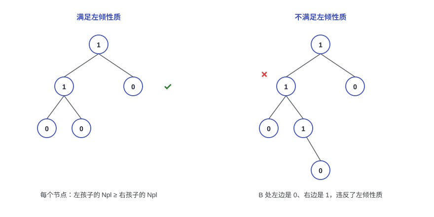
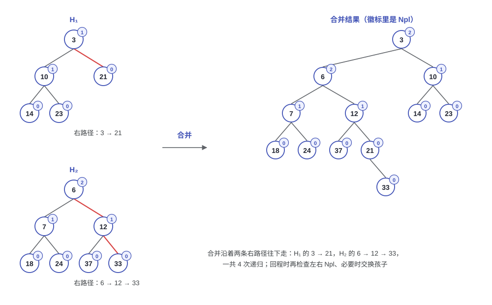
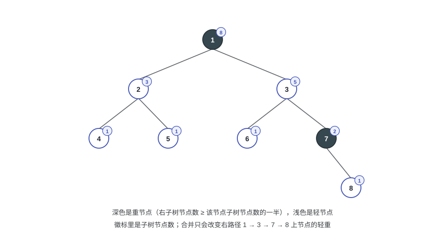

# 第四讲：左倾堆与斜堆（Leftist Heaps and Skew Heaps）

> 二叉堆什么都会，就是合并很慢：把两个堆并起来只能重建，代价 O(N)。这一讲的两个结构专门冲着合并来，把合并做到 O(log N) 之后，插入（跟一个单节点堆合并）和删除最小元（摘掉根再合并两棵子树）都顺带解决。左倾堆（leftist heap）给每个节点记一个零路径长度，保证右路径短；斜堆（skew heap）把零路径长度也省了，代价是复杂度只能摊还地看。

---

## 1. 从二叉堆到可并堆（Mergeable Heap）

### 1.1 二叉堆的合并代价

堆（heap）靠两个性质撑着：结构性质（structure property）是"完全二叉树，可以用数组存"，堆序性质（order property）是"父节点的 key 不大于孩子"。这两个性质让插入和删除最小元都是 O(log N)，但合并很难看：两个数组形式的完全二叉树没法直接拼起来，只能把所有元素取出来重新建堆，代价 O(N)。

所以有一个自然的问题：如果沿用二叉堆的结构，合并两个堆最快能多快？答案是 O(N)。原因就在结构性质上，两个完全二叉树的元素集合合起来一般不再是一棵完全二叉树，只能重建。

### 1.2 目标：把合并变成 O(log N)

换一个思路，把合并（merge）当成第一公民。只要合并是 O(log N)，另外两个操作都能归到它：

| 操作 | 做法 | 复杂度 |
|------|------|--------|
| Insert(X) | 把 X 看成一个只有单节点的堆，和新堆合并 | O(log N) |
| DeleteMin | 摘掉根，把左右两棵子树合并 | O(log N) |
| Merge(H₁, H₂) | 见 2.4 节 | O(log N) |

这样的堆叫可并堆（mergeable heap）。代价是结构和二叉堆不一样了：树不再要求完全，只在必要的地方保持平衡。

---

## 2. 左倾堆（Leftist Heap）

### 2.1 零路径长度（Null Path Length）

> [!NOTE]
> **定义：零路径长度（null path length, Npl）**
>
> 节点 $X$ 的零路径长度 $\mathrm{Npl}(X)$ 是从 $X$ 走到"没有两个孩子的节点"的最短路径长度。规定 $\mathrm{Npl}(\mathrm{NULL}) = -1$。
>
> 等价的递推写法：$\mathrm{Npl}(X) = \min\{\mathrm{Npl}(C) + 1 : C \text{ 是 } X \text{ 的孩子}\}$。

这个定义只关心"最短"，所以一个节点只要缺了某一个孩子，它的 Npl 就是 0；叶子的 Npl 也是 0。

### 2.2 左倾性质（leftist property）

> [!NOTE]
> **定义：左倾性质**
>
> 堆里的每个节点 $X$ 都满足 $\mathrm{Npl}(\text{左孩子}) \ge \mathrm{Npl}(\text{右孩子})$。

这条性质把树"往左压"：左边可以很长，右边一定很短。配合 Npl 的递推写法还能得到一个常用的结论：左倾堆里每个节点的 Npl 都等于它右孩子的 Npl 加一。



上图左边满足左倾性质；右边 B 的左孩子 Npl 是 0、右孩子是 1，违反了左倾性质，这种形状会让"往右走"的路变长。

### 2.3 右路径有多长

右路径（right path）就是从根出发一直走右孩子得到的那条路径。它多长，直接决定了合并要跑多久。

> [!NOTE]
> **定理**
>
> 右路径上有 $r$ 个节点的左倾树，至少有 $2^r - 1$ 个节点。

证明分两步：

1. 先证一个更强的说法：如果 $\mathrm{Npl}(X) = n$，那么以 $X$ 为根的子树至少有 $2^{n+1} - 1$ 个节点。$n = 0$ 时子树至少有 $X$ 自己，$2^1 - 1 = 1$ 成立；假设对 $n - 1$ 成立，$\mathrm{Npl}(X) = n$ 说明右孩子的 Npl 是 $n - 1$，而左孩子的 Npl 不小于它，两棵子树都至少有 $2^n - 1$ 个节点，加上 $X$ 自己就是 $2^{n+1} - 1$。
2. 右路径有 $r$ 个节点，说明根的 Npl 是 $r - 1$（每往右走一步 Npl 减一，最后一个节点的 Npl 为 0），代入上一条就得到节点数 $N \ge 2^r - 1$。

把不等式反过来解：$r \le \log_2(N + 1)$。也就是说，$N$ 个节点的左倾堆，右路径长度是 $O(\log N)$。合并只沿着右路径走，这就是它能做到 $O(\log N)$ 的原因。

### 2.4 合并（Merge）

合并的思路：两个根先比大小，小的那个当新根；然后把"另一个堆"和"小根堆的右子树"合并，结果挂回小根的右边；从递归里回来的时候，如果左孩子的 Npl 比右孩子小，就交换两个孩子，最后更新 Npl。

设 $H_1$ 的根比 $H_2$ 小，三步走：

1. 递归合并 $H_1$ 的右子树和 $H_2$：`H1->Right = Merge(H1->Right, H2)`；
2. 如果 $\mathrm{Npl}(\text{左孩子}) < \mathrm{Npl}(\text{右孩子})$，交换两个孩子；
3. 更新 $\mathrm{Npl}(H_1) = \mathrm{Npl}(\text{右孩子}) + 1$。



拿图里的例子走一遍：$H_1$ 的右路径是 $3 \to 21$，$H_2$ 的右路径是 $6 \to 12 \to 33$。

```text
merge(3 的右子树 = 21, 6)
  merge(6 的右子树 = 12, 21)
    merge(12 的右子树 = 33, 21)
      merge(21 的右子树 = NULL, 33) = 33
```

回来的时候逐层检查：

- 21 只有右孩子 33，交换后 33 变成左孩子，$\mathrm{Npl}(21) = 0$；
- 12 的左右孩子 Npl 都是 0，不用换，$\mathrm{Npl}(12) = 1$；
- 6 的左右孩子 Npl 都是 1，不用换，$\mathrm{Npl}(6) = 2$；
- 3 的左孩子（10）Npl 是 1，右孩子（6）Npl 是 2，交换，$\mathrm{Npl}(3) = 2$。

合并一共递归了 4 次，正好是两条右路径节点数之和减一；每一步都往右走，所以总代价是 $O(\log N)$。

### 2.5 插入与删除最小元

- Insert(X)：新建一个只有 X 的堆，和原来的堆合并。走的还是右路径，$O(\log N)$。
- DeleteMin：根就是最小元，摘掉它之后剩下左右两棵子树，把它们合并起来就是新堆，也是 $O(\log N)$。

### 2.6 代码

合并的递归写法很短，注意 `Merge1` 里的两种情况：`H1` 只有一个孩子（`H1->Left == NULL`，这时 `H1->Right` 一定是 NULL）时直接把 `H2` 挂到左边；否则先递归合并右子树，再决定要不要交换。

```cpp
typedef struct TreeNode *PriorityQueue;

PriorityQueue Merge( PriorityQueue H1, PriorityQueue H2 )
{
    if ( H1 == NULL ) return H2;
    if ( H2 == NULL ) return H1;
    if ( H1->Element < H2->Element )
        return Merge1( H1, H2 );
    else
        return Merge1( H2, H1 );
}

static PriorityQueue Merge1( PriorityQueue H1, PriorityQueue H2 )
{
    if ( H1->Left == NULL )          /* 单节点：右孩子和 Npl 都已经是 0 */
        H1->Left = H2;
    else {
        H1->Right = Merge( H1->Right, H2 );      /* 第 1、2 步 */
        if ( H1->Left->Npl < H1->Right->Npl )
            SwapChildren( H1 );                  /* 第 3 步 */
        H1->Npl = H1->Right->Npl + 1;
    }
    return H1;
}
```

节点里多存一个 `Npl` 字段：

```cpp
struct TreeNode
{
    ElementType   Element;
    PriorityQueue Left;
    PriorityQueue Right;
    int           Npl;
};
```

> [!WARNING]
> **Npl 忘了更新会怎样？**
>
> `Npl` 不是一个装饰字段，交换的判断完全靠它。如果合并之后不更新，字段值和真实结构就会脱节，该交换的时候不交换，右路径可能越走越长，合并也就退化到 $O(N)$ 了。

### 2.7 迭代版

同样的事情也可以自底向上做，幻灯片给了这个视角：

1. 沿着两条右路径往下，把它们按 key 大小"排"成一条新的右路径，路过的节点左孩子都不动；
2. 自底向上走回来，逐个比较左右孩子的 Npl，需要就交换，并更新 Npl。

两种写法结果一样，递归版代码短，迭代版不占递归栈。

---

## 3. 斜堆（Skew Heap）

### 3.1 合并规则

斜堆是左倾堆的简化版：不要 Npl，也不要"要不要交换"的判断。合并时沿着右路径往下走，回来的时候每次都交换左右孩子，唯一的例外是两条右路径上最大的那个节点，它是递归的终点，不交换。

还是用 2.4 节那两个堆：$H_1 = 3(10(14, 23), 21)$，$H_2 = 6(7(18, 24), 12(37, 33))$。斜堆合并后是

```text
3( 6( 12( 21(33, –), 37 ), 7(18, 24) ), 10(14, 23) )
```

和左倾堆的结果（$3(6(7(18, 24), 12(37, 21(33))), 10(14, 23))$）比一比，差别就在 6 的左右孩子被交换了：斜堆不问 Npl，走到哪换到哪。

### 3.2 优点与代价

斜堆的优点是省：

- 每个节点不用存 Npl，少一个字段；
- 不用比较 Npl 决定是否交换，代码更短。

代价是树不再保证"左倾"，单次操作的右路径可能很长，最坏情况到 $O(N)$。所以它的复杂度是均摊的：

> [!NOTE]
> **目标**
>
> 从空堆开始的任意 $M$ 次连续操作，总时间不超过 $O(M \log N)$。

### 3.3 均摊分析：重节点与轻节点

用势能法（potential method）。先给节点分个类：

> [!NOTE]
> **定义：重节点（heavy node）**
>
> 节点 $p$ 是重的，如果它右子树的节点数不小于以 $p$ 为根的子树节点数的一半；否则是轻的。节点数都把自己算进去。

势能函数取堆里重节点的个数：

$$\Phi(D) = \#\{\text{重节点}\}$$

从空堆开始 $\Phi(D_0) = 0$，任何时刻 $\Phi(D_i) \ge 0$，满足势能函数的两个要求。



设要合并的两个斜堆 $H_1$、$H_2$ 的右路径上分别有 $l_1$、$l_2$ 个轻节点和 $h_1$、$h_2$ 个重节点，两条右路径以外的重节点有 $h$ 个。

实际代价：合并只走两条右路径，代价就是路径上的节点总数，

$$c = l_1 + l_2 + h_1 + h_2$$

势能变化：只有右路径上的节点会改变轻重。右路径上的重节点合并后一定变成轻节点（交换之后"左轻右重"变成了"左重右轻"，新的右子树就是原来的左子树，不到一半）；右路径上的轻节点则可能变成重节点。所以

$$\Phi(D_0) = h_1 + h_2 + h, \qquad \Phi(D_N) \le l_1 + l_2 + h$$

$$\Phi(D_N) - \Phi(D_0) \le l_1 + l_2 - h_1 - h_2$$

均摊代价：

$$\hat c = c + \Phi(D_N) - \Phi(D_0) \le 2(l_1 + l_2)$$

最后看轻节点的性质：轻意味着右子树的节点数不到一半，所以沿着右路径每遇到一个轻节点，子树大小至少减半，右路径上的轻节点数不超过 $\log N$。于是

$$\hat c \le 2(l_1 + l_2) = O(\log N_1 + \log N_2)$$

插入和删除都只是合并，它们的均摊复杂度也是 $O(\log N)$。

### 3.4 和左倾堆的对比

| | 左倾堆 | 斜堆 |
|------|--------|------|
| 交换条件 | 左孩子 Npl 小于右孩子才换 | 每次都换，最后一个节点除外 |
| 额外字段 | 每个节点一个 Npl | 无 |
| 合并复杂度 | 最坏 $O(\log N)$ | 均摊 $O(\log N)$，单次可能到 $O(N)$ |
| 代码长度 | 多一个比较和 Npl 维护 | 递归两行就能写出来 |

---

## 4. 小结

| 操作 | 二叉堆 | 左倾堆 | 斜堆 |
|------|--------|--------|------|
| Merge | $O(N)$ | $O(\log N)$ | 均摊 $O(\log N)$ |
| Insert | $O(\log N)$ | $O(\log N)$ | 均摊 $O(\log N)$ |
| DeleteMin | $O(\log N)$ | $O(\log N)$ | 均摊 $O(\log N)$ |
| 每个节点额外空间 | 无（数组） | Npl 字段 | 无 |
| 单次最坏情况 | 稳定 | 稳定 | 可能退化到 $O(N)$ |

另外，这两种堆的期望右路径长度至今没有精确结果，还是个公开问题。

## 参考资料

1. M. A. Weiss, *Data Structure and Algorithm Analysis in C* (2nd Edition): Ch.5（p.161–169，左倾堆与斜堆，含右路径定理的归纳证明），Ch.11（p.435–437，均摊分析）。
2. [OI Wiki](https://oi-wiki.org/ds/leftist-tree/)：左偏树。课件以外的实现参考，把同一个合并逻辑写成了数组版本，可以对照 2.4 节的递归写法。
3. 课程材料：第四讲课件，以及《左倾堆势能分析》《Book-Leftist heap and skew heap》两份材料。
