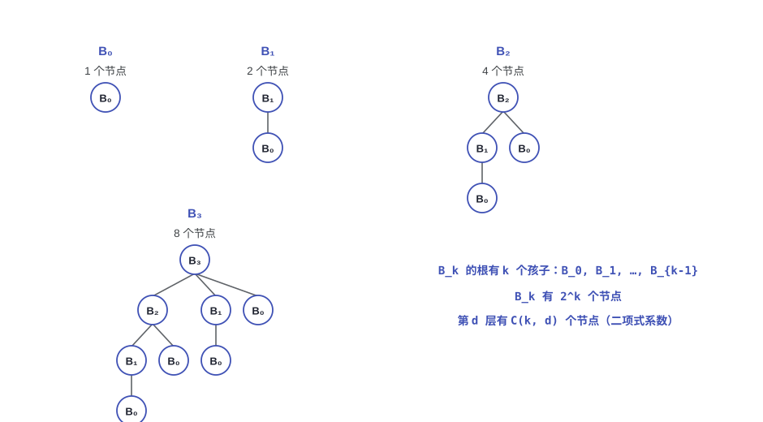
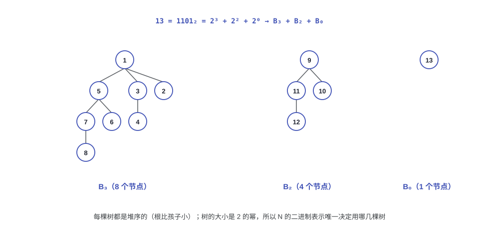
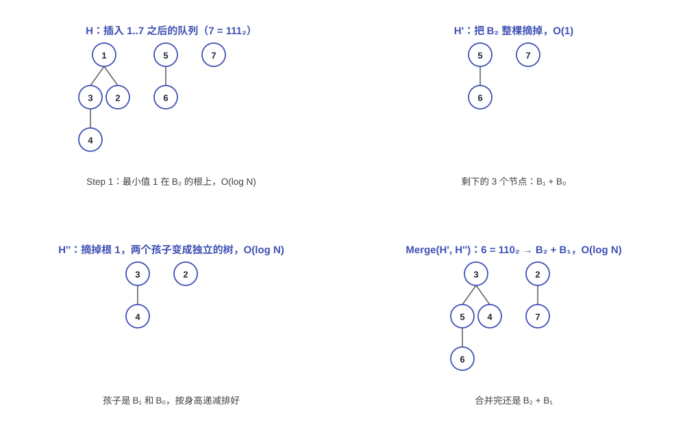
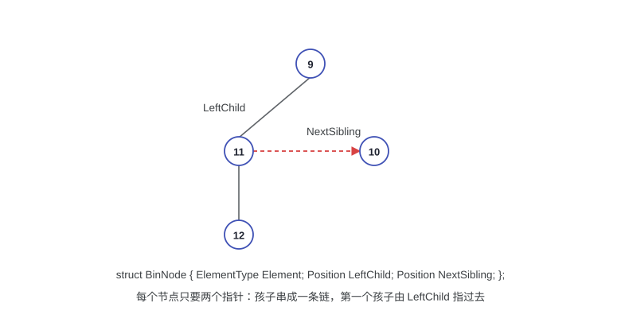

# 第五讲：二项队列（Binomial Queues）

> 左倾堆和斜堆把元素都装在一棵树里，合并沿着右路径走。二项队列换了个思路：一个队列是"一片二项树"（forest），每棵树的大小都是 2 的幂，合并就成了二进制加法，插入的均摊代价降到 O(1)。代价是最小值不保证在唯一的根上，FindMin 要多看几个根（缓存最小值之后还是 O(1)）。

---

## 1. 为什么还要一种堆

### 1.1 二叉堆的插入：平均快，最坏不快

二叉堆的插入（percolate up）最坏是 O(log N)：如果新元素比堆里所有元素都小，它要一路上浮到根。平均情况好得多，教材（Weiss）给的统计是平均 2.607 次比较、平均上移 1.607 层，可以说"平均是常数"。但平均不是保证，N 次插入的最坏情况仍然是 O(N log N)。

二项队列要的就是一个结构性的结论：从空队列开始做 N 次插入，总时间 O(N)，而且这个界对任何输入序列都成立。

顺带对比一下二叉堆的建堆：把 N 个元素一次性自底向上 `PercolateDown`（BuildHeap）是 O(N) 的，因为所有节点的高度之和是 O(N)。Weiss 的 Theorem 5.1 给出了完美二叉树的高度和：高度为 $b$、有 $2^{b+1}-1$ 个节点的完美二叉树，所有节点高度之和是 $2^{b+1}-1-(b+1)$；对一般的完全二叉树，这个和是 $N - b(N)$（$b(N)$ 是 $N$ 的二进制表示里 1 的个数），同样不超过 $N$。

### 1.2 二项树（Binomial Tree）

> [!NOTE]
> **定义：二项树**
>
> - $B_0$ 是只有一个节点的树；
> - $B_k$ 由两棵 $B_{k-1}$ 拼成：把一棵 $B_{k-1}$ 接到另一棵 $B_{k-1}$ 的根上。



从定义能直接看出几条性质：

- $B_k$ 恰好有 $2^k$ 个节点（每拼一次翻一倍）；
- $B_k$ 的根有 $k$ 个孩子，从左到右分别是 $B_0, B_1, \dots, B_{k-1}$；
- $B_k$ 第 $d$ 层的节点数是二项式系数 $\binom{k}{d}$，"二项树"的名字就是这么来的；把所有层加起来正好是 $(1+1)^k = 2^k$。

所以二项树的高度是 $k$，节点数却是指数级的：$k = \log_2 N$。这是它后面所有操作都是 $O(\log N)$ 的根源。

---

## 2. 二项队列：一片二项树

二项队列（binomial queue）不是一棵堆序树，而是一片二项树组成的森林（forest），每棵树自己满足堆序（根比孩子小）。

> [!NOTE]
> **结构性质**
>
> 每种高度至多出现一棵树。

因为 $B_k$ 有 $2^k$ 个节点，这一条要求就等价于把元素个数 $N$ 写成二进制：$N$ 的二进制里第 $k$ 位是 1，队列里就有一棵 $B_k$。



比如 $13 = 1101_2 = 2^3 + 2^2 + 2^0$，队列就是 $B_3 + B_2 + B_0$，正好三棵树。反过来说，任何一个 $N$ 的表示方式都是唯一的。

---

## 3. 操作

### 3.1 FindMin

堆序保证最小值一定在某个根上，而队列里最多有 $\lceil \log N \rceil + 1$ 个根，所以扫一遍是 $O(\log N)$。如果额外记一个最小值指针，插入和删除时顺手更新，FindMin 就是 $O(1)$。

### 3.2 Merge：二进制加法

合并两个二项队列，就是把两个二进制数加起来：从低位（矮树）往高位（高树）逐位处理，遇到两棵同高的树就合并成一棵更高的树，也就是进位。

每一位有三个来源：$H_1$ 这一位的树、$H_2$ 这一位的树、上一位的进位 Carry。按这三位的取值分 8 种情况：

| Carry T2 T1 | 这一位怎么处理 |
|------|----------------|
| 000 | 什么都没有，这一位以及更高的位都不用看了，结束 |
| 001 | 只有 $H_1$ 的树，原样保留 |
| 010 | 只有 $H_2$ 的树，搬进 $H_1$ |
| 100 | 只有进位，把它放进 $H_1$，进位清空 |
| 011 | $T_1$ 和 $T_2$ 同高，合并成新的进位 |
| 101 | $T_1$ 和进位同高，合并成新的进位 |
| 110 | $T_2$ 和进位同高，合并成新的进位 |
| 111 | $H_1$ 这一位放进位，$T_1$ 和 $T_2$ 合并成新的进位 |

两棵同高的树怎么合并，就是 `CombineTrees`：把根大的那棵接到根小的那棵下面（保持堆序），并且新接进来的树放在孩子链表的最前面。

```
BinTree CombineTrees( BinTree T1, BinTree T2 )
{   /* 合并两棵等高的树 */
    if ( T1->Element > T2->Element )
        return CombineTrees( T2, T1 );   /* 把大的接到小的下面 */
    T2->NextSibling = T1->LeftChild;     /* T2 插到 T1 孩子链表头部 */
    T1->LeftChild = T2;
    return T1;
}   /* T_p = O(1) */
```

合并的总代价是两条"进位链"的长度，不超过两边的树数，也就是 $O(\log N)$。课件里的例子就是 $6 + 7$：$110_2 + 111_2 = 1101_2 = 13$。

### 3.3 Insert：和单节点队列合并

插入就是把新元素当成一个只有 $B_0$ 的队列，和原队列合并。如果当前队列里"最小的空树"是 $B_i$，这次插入要一路进位到第 $i$ 位，代价是 $Const \cdot (i+1)$。

从空队列开始插入 1 到 7 的过程就是二进制计数：

| 插入后元素个数 | 队列里的树 |
|----------------|------------|
| 1 = 1₂ | $B_0$ |
| 2 = 10₂ | $B_1$ |
| 3 = 11₂ | $B_1 + B_0$ |
| 4 = 100₂ | $B_2$ |
| 5 = 101₂ | $B_2 + B_0$ |
| 6 = 110₂ | $B_2 + B_1$ |
| 7 = 111₂ | $B_2 + B_1 + B_0$ |

N 次插入的总时间是 $O(N)$（见第 4 节的两个证明），所以插入均摊 $O(1)$；但单次插入仍然可能进位 $\log N$ 次，最坏是 $O(\log N)$。

### 3.4 DeleteMin

删除最小值分四步：



1. 在所有根里找最小值，记下它在哪棵树 $B_k$ 上：$O(\log N)$；
2. 把这棵 $B_k$ 整个从队列里摘掉，得到 $H'$：$O(1)$；
3. 摘掉 $B_k$ 的根，它的孩子正好是 $B_0, B_1, \dots, B_{k-1}$，把这一串孩子整理成一个新的队列 $H''$：$O(\log N)$；
4. 合并 $H'$ 和 $H''$：$O(\log N)$。

总的还是 $O(\log N)$。注意第 3 步里"整理"的意思：孩子链表按树的大小从大到小串好了，只要顺着 `NextSibling` 走一遍，依次放进数组对应的下标就行。

---

## 4. 插入的均摊分析：N 次插入 O(N)

### 4.1 聚合分析（aggregate analysis）

一次插入的代价 = 1（新建 $B_0$）+ 进位次数。进位次数等于"插入后元素个数 $i$ 的二进制末尾有多少个连续的 1"。

把 $N$ 次插入加起来看总账：

- 每次插入至少花 1 步，一共 $N$ 步；
- 进位的总次数是 $\frac{N}{2} + \frac{N}{4} + \frac{N}{8} + \dots < N$：末尾恰好有 1 个 1 的情况占一半，恰好有 2 个 1 的占四分之一，依此类推。

两步加起来 $O(N)$，所以平均每次插入 $O(1)$。这就是"贵的插入会清掉很多树，便宜的插入会种出新树"的直观说法。

### 4.2 势能法（potential method）

取势能函数 $\Phi(D_i) = $ 第 $i$ 次插入后森林里的树数（从空队列开始 $\Phi(D_0) = 0$，任何时刻非负）。

设某次插入的代价是 $c$（包含 $c-1$ 次进位）：这次插入新种了一棵 $B_0$（树数 +1），每进位一次少一棵树（树数 −1），所以

$$\Phi(D_i) - \Phi(D_{i-1}) = 1 - (c - 1) = 2 - c$$

均摊代价就是

$$\hat c_i = c + \Phi(D_i) - \Phi(D_{i-1}) = c + (2 - c) = 2$$

每次插入的均摊代价是常数 2。把 $N$ 次加起来：

$$\sum_{i=1}^{N} c_i = \sum_{i=1}^{N} \hat c_i + \Phi(D_0) - \Phi(D_N) = 2N - \Phi(D_N) \le 2N$$

也就是 $O(N)$。对比一下：单次插入最坏 $O(\log N)$，均摊是 $O(1)$。

---

## 5. 实现

### 5.1 数据结构：数组 + 孩子-兄弟表示

队列本身就是一个数组，`TheTrees[i]` 指向那棵 $B_i$ 的根，同时记一下总节点数：

```c
typedef struct BinNode *Position;
typedef struct Collection *BinQueue;
typedef struct BinNode *BinTree;

struct BinNode {
    ElementType Element;
    Position    LeftChild;
    Position    NextSibling;
};

struct Collection {
    int      CurrentSize;          /* 总节点数 */
    BinTree  TheTrees[ MaxTrees ]; /* TheTrees[i] 是 B_i 的根 */
};
```

树用"孩子-兄弟"（left-child / right-sibling）表示：每个节点只有两个指针，`LeftChild` 指向第一个孩子，孩子们用 `NextSibling` 串成一条链。



这样安排是为了两件事：

- DeleteMin 要快速拿到所有子树：摘掉根之后，顺着 `NextSibling` 走一遍就得到 $B_{k-1}, B_{k-2}, \dots, B_0$，恰好是数组里从高到低的一段；
- Merge 时要合并得便宜：`CombineTrees` 把新树插到孩子链表的最前面就够了，不用遍历孩子。因为合并出来的树总是越来越大，放在链头的正好是最大的子树，符合"孩子按高度从大到小排列"的顺序。

### 5.2 Merge 的代码

```c
BinQueue Merge( BinQueue H1, BinQueue H2 )
{
    BinTree T1, T2, Carry = NULL;
    int i, j;

    if ( H1->CurrentSize + H2->CurrentSize > Capacity ) ErrorMessage();
    H1->CurrentSize += H2->CurrentSize;
    for ( i = 0, j = 1; j <= H1->CurrentSize; i++, j *= 2 ) {
        T1 = H1->TheTrees[i];
        T2 = H2->TheTrees[i];
        switch ( 4 * !!Carry + 2 * !!T2 + !!T1 ) {
            case 0:  /* 000 */
            case 1:  /* 001 */  break;
            case 2:  /* 010 */  H1->TheTrees[i] = T2; H2->TheTrees[i] = NULL; break;
            case 4:  /* 100 */  H1->TheTrees[i] = Carry; Carry = NULL; break;
            case 3:  /* 011 */  Carry = CombineTrees( T1, T2 );
                                H1->TheTrees[i] = H2->TheTrees[i] = NULL; break;
            case 5:  /* 101 */  Carry = CombineTrees( T1, Carry );
                                H1->TheTrees[i] = NULL; break;
            case 6:  /* 110 */  Carry = CombineTrees( T2, Carry );
                                H2->TheTrees[i] = NULL; break;
            case 7:  /* 111 */  H1->TheTrees[i] = Carry;
                                Carry = CombineTrees( T1, T2 );
                                H2->TheTrees[i] = NULL; break;
        }
    }
    return H1;
}
```

`switch` 里那三个感叹号是把指针变成 0/1，三种来源正好凑成一个八进制数，这就是 3.2 节那张表。

### 5.3 DeleteMin 的代码

```c
ElementType DeleteMin( BinQueue H )
{
    BinQueue DeletedQueue;
    Position DeletedTree, OldRoot;
    ElementType MinItem = Infinity;
    int i, j, MinTree;

    if ( IsEmpty( H ) ) { PrintErrorMessage(); return -Infinity; }

    for ( i = 0; i < MaxTrees; i++ ) {      /* Step 1: 找最小值 */
        if ( H->TheTrees[i] && H->TheTrees[i]->Element < MinItem ) {
            MinItem = H->TheTrees[i]->Element;
            MinTree = i;
        }
    }

    DeletedTree = H->TheTrees[ MinTree ];
    H->TheTrees[ MinTree ] = NULL;          /* Step 2: 把 B_k 摘下来 => H' */

    OldRoot = DeletedTree;                  /* Step 3.1: 摘掉根 */
    DeletedTree = DeletedTree->LeftChild;
    free( OldRoot );

    DeletedQueue = Initialize();            /* Step 3.2: 孩子们组成 H'' */
    DeletedQueue->CurrentSize = ( 1 << MinTree ) - 1;   /* 2^MinTree - 1 */
    for ( j = MinTree - 1; j >= 0; j-- ) {
        DeletedQueue->TheTrees[j] = DeletedTree;
        DeletedTree = DeletedTree->NextSibling;
        DeletedQueue->TheTrees[j]->NextSibling = NULL;
    }

    H->CurrentSize -= DeletedQueue->CurrentSize + 1;
    H = Merge( H, DeletedQueue );           /* Step 4: 合并 H' 和 H'' */
    return MinItem;
}
```

第 1 步的循环用 `MaxTrees` 是偷懒写法，换成"实际有多少棵树"也行；`CurrentSize` 就是为这类地方准备的。

---

## 6. 小结

和前面几种堆放在一起：

| 操作 | 二叉堆 | 左倾堆 | 斜堆 | 二项队列 |
|------|--------|--------|------|----------|
| FindMin | $O(1)$ | $O(1)$ | $O(1)$ | $O(\log N)$，缓存后 $O(1)$ |
| DeleteMin | $O(\log N)$ | $O(\log N)$ | 均摊 $O(\log N)$ | $O(\log N)$ |
| Insert | $O(\log N)$（平均 $O(1)$） | $O(\log N)$ | 均摊 $O(\log N)$ | 均摊 $O(1)$，最坏 $O(\log N)$ |
| Merge | $O(N)$ | $O(\log N)$ | 均摊 $O(\log N)$ | $O(\log N)$ |

二项队列的特点是合并和插入都很便宜：N 次插入只要 O(N)，合并又只要 $O(\log N)$；代价是 FindMin 从 $O(1)$ 变成要看几个根，这个缺点用缓存最小值就能补回来。

这一讲配套的项目是用堆实现最短路径算法：以 Dijkstra 为主，试不同的优先队列（包括 Fibonacci 堆）看哪个最适合，具体以项目要求为准。

## 参考资料

1. M. A. Weiss, *Data Structure and Algorithm Analysis in C* (2nd Edition): Ch.5（p.170–180，二项队列），Ch.11（p.430–435，均摊分析）。补充材料是教材的 p.150–151（二叉堆的插入、平均只上移 1.607 层）和 p.156–157（Theorem 5.1 与高度和的证明）。
2. T. H. Cormen, C. E. Leiserson, R. L. Rivest, C. Stein, *Introduction to Algorithms* (3rd Edition): Ch.19（p.505–530，二项堆）。
3. [OI Wiki](https://oi-wiki.org/)：[堆简介](https://oi-wiki.org/ds/heap/)，里面有一张二叉堆、左偏树、二项堆、斐波那契堆的复杂度对照表，可以和第 6 节的结果互相印证；另外 [pb_ds 优先队列](https://oi-wiki.org/lang/pb-ds/pq/) 里可以直接用 `binomial_heap_tag` 声明一个二项堆。
4. 课程材料：第五讲课件《Binomial Queue》，以及随课件发的两份教材页扫描。
