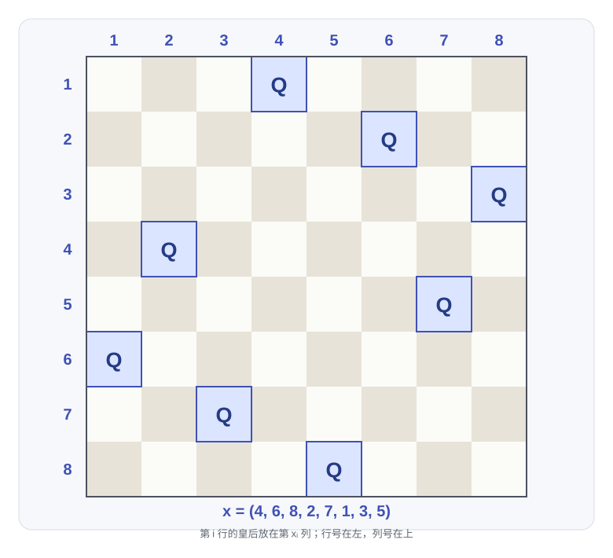
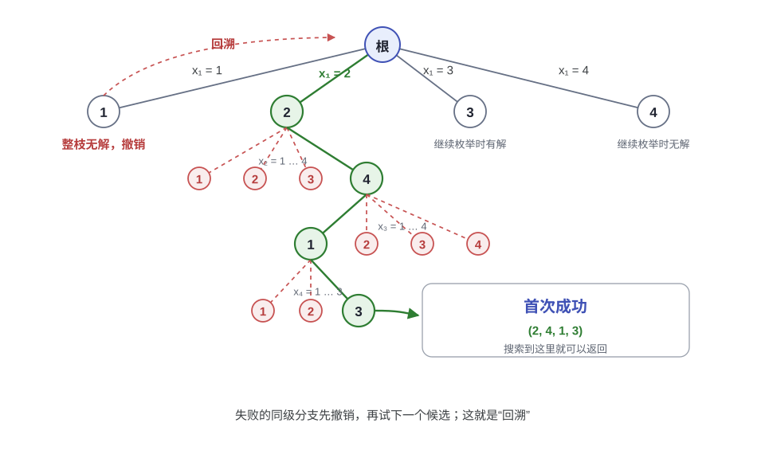
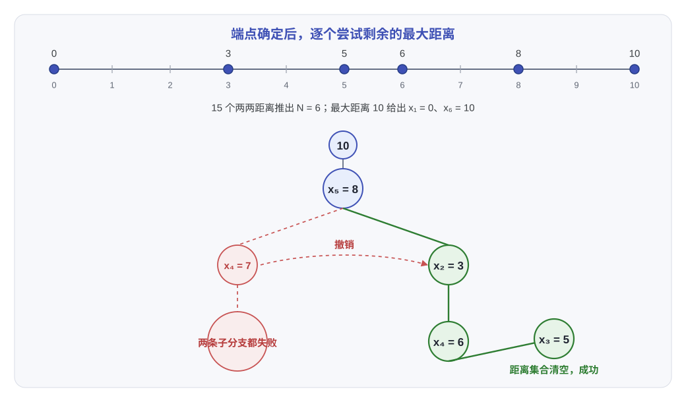
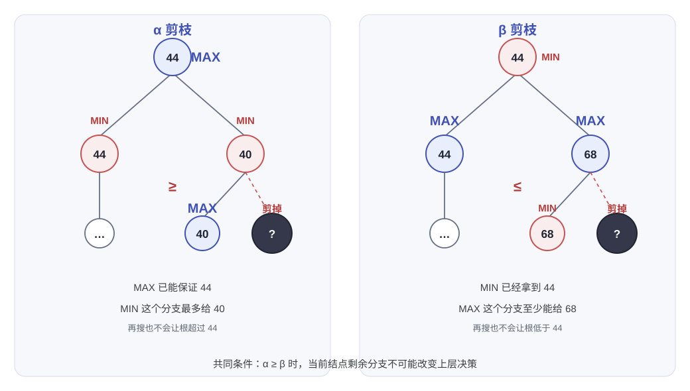

# 第六讲：回溯（Backtracking）

> 枚举所有候选解当然能得到答案，真正麻烦的是怎样少走几条死路。回溯（backtracking）把候选解一层层拼起来，每加一个分量就检查当前部分解（partial solution）还能不能继续；走不通就撤销，换下一个分支。八皇后、Turnpike 重建和棋类搜索看起来差得很远，用的都是这套“选择、检查、递归、撤销”的结构。

---

## 1. 回溯的基本框架（Backtracking）

### 1.1 候选空间与部分解

一个问题如果有 $n$ 个待定分量，第 $i$ 个分量记作 $x_i$，候选集合记作 $S_i$，那么完整的候选空间就是

$$
S_1 \times S_2 \times \cdots \times S_n.
$$

回溯不会先把这个集合全部生成出来，它只维护当前走到的一小段：

$$
(x_1,x_2,\dots,x_i),\qquad 0\le i<n.
$$

这段叫部分解。把 $x_{i+1}\in S_{i+1}$ 接上去以后，`Check` 判断新状态是否违反限制 $R$。没有违反就继续往下走；违反就舍弃这个候选，回到 $(x_1,\dots,x_i)$ 再试别的值。

这里有一个隐含条件：失败必须能向外传播。如果某个部分解已经不可能补成合法解，那么它的所有扩展也都不可能合法，这时剪枝才是安全的。只检查一部分约束是常见优化，但前提仍然是“当前错，后面不可能改对”。

### 1.2 深度优先搜索（Depth-First Search）

候选解构成一棵逻辑上的状态空间树（state-space tree）：

- 根表示还没有选择任何分量；
- 深度 $i$ 的一个结点表示一个部分解 $(x_1,\dots,x_i)$；
- 一条从根到叶子的路径表示一个完整候选解；
- 在某个结点被 `Check` 拒绝的子树可以直接不搜。

搜索顺序是深度优先（depth-first search, DFS）。先沿一条路走到叶子或者遇到冲突，再退回最近的分叉点。所谓“回溯”，就是把这一步改过的状态恢复原样。

这棵树通常只存在于递归调用的形状里，不会真的 new 出几十万个结点。显式建树反而多花内存，也丢掉了回溯“不需要预先展开”的好处。

```text
Backtracking(i):
    if i > n:
        return true                   // 已经得到完整解

    for each x_i in S_i:
        if Check((x_1, ..., x_{i-1}, x_i), R):
            Apply(x_i)
            Found = Backtracking(i + 1)
            if Found:
                return true
            Undo(x_i)                 // 这条分支失败，恢复现场

    return false
```

如果要求找全部解，就不能在第一个 `Found` 处立刻返回。每试完一个候选，无论成功还是失败，都要恢复共享状态，再进入下一个候选。

`Undo` 很容易漏。最典型的情况是用一个 `used` 数组标记某个元素已经选过，递归出来后必须改回 `false`。如果状态是写在递归参数里的，例如把几个位掩码直接传给下一层，那么函数返回时旧参数天然还在，不需要额外撤销。

### 1.3 分支顺序

不同层的候选集合大小不一定相同。如果 $S_i$ 的选择明显少，把它放到更前面，通常能更早砍掉大树。

无剪枝枚举时，交换两层不改变叶子总数。实际搜索常在浅层失败，把约束强、分支少的层提前，后面的整块子树就可能不用展开。寻找第一个解或最优解时，好的顺序也可能让它更早出现。

---

## 2. 八皇后（Eight Queens）

### 2.1 问题与表示

要在 $8\times 8$ 的棋盘上放 8 个皇后，使任意两个皇后都不在同一行、同一列、同一条对角线（diagonal）或反对角线（antidiagonal）上。

每一行恰好放一个皇后，所以第 $i$ 行的皇后记作 $Q_i$，它所在的列记作 $x_i$。一个完整解可以写成

$$
(x_1,x_2,\dots,x_8).
$$

列号不允许重复，因此解一定是 $1,2,\dots,8$ 的一个排列（permutation）。候选数量从盲目的

$$
8^8=16\,777\,216
$$

降到

$$
8! = 40\,320.
$$

然后检查两条斜线，还能继续砍掉大量前缀。

> [!NOTE]
> **八皇后的约束**
>
> 对任意 $i\ne j$：
>
> - 不能同列：$x_i\ne x_j$；
> - 不能同对角线：$\lvert x_i-x_j\rvert\ne \lvert i-j\rvert$。
>
> 第二种等价于
>
> $$
> \frac{x_i-x_j}{i-j}\ne 1
> \quad\text{且}\quad
> \frac{x_i-x_j}{i-j}\ne -1.
> $$

下面是合法解

$$
(4,6,8,2,7,1,3,5).
$$



读图时先看第 1 行到第 8 行，每行恰有一个皇后；再看列号，4、6、8、2、7、1、3、5 正好各出现一次。最后抽查几对皇后，横坐标之差都不等于行号之差。

### 2.2 四皇后的搜索树

四皇后更容易把分支画出来。按列号从小到大搜索，第一个解是

$$
(2,4,1,3).
$$

从根出发，$x_1=1$ 的整棵子树都没有解，只能退回根，改试 $x_1=2$。进入这个分支后，$x_2=1,2,3$ 都与已经放下的皇后冲突，只有 $x_2=4$ 可行；$x_3$ 再取 1；到了第 4 行，$x_4=1,2$ 都冲突，$x_4=3$ 才得到第一个合法摆法。



图中的红线是失败和撤销，绿色路径是第一次搜到解的路径。四皇后一共有两个解，另一个是 $(3,1,4,2)$；找到第一个解就停止时，后一个分支不会进入。

八皇后完整枚举有 92 个解，通常拿来当程序检查值。

### 2.3 位掩码实现

逐行放置时，只需要知道当前列、两条斜线有没有冲突。三个整数就能表示这些状态：

- `cols` 记录已经占用的列；
- `diag1` 记录向左下方延伸的冲突位；
- `diag2` 记录向右下方延伸的冲突位。

进入下一行时，两条斜线分别左移和右移一位。`available` 的每一个 1 都代表一个当前可放皇后的列。

```cpp
#include <iostream>

int n;
int fullMask;
int answer;

void dfs(int row, int cols, int diag1, int diag2) {
    if (row == n) {
        ++answer;
        return;
    }

    int available = fullMask & ~(cols | diag1 | diag2);
    while (available != 0) {
        int bit = available & -available;  // 取最低位的 1
        available -= bit;

        dfs(row + 1,
            cols | bit,
            ((diag1 | bit) << 1) & fullMask,
            (diag2 | bit) >> 1);
    }
}

int main() {
    n = 8;
    fullMask = (1 << n) - 1;
    dfs(0, 0, 0, 0);
    std::cout << answer << '\n';  // 92
}
```

这段程序把状态放在参数里，返回上一层时 `cols`、`diag1`、`diag2` 仍是调用前的值，所以没有显式 `Undo`。如果改用全局数组或集合，必须自己恢复。

位运算把“判断某个位置能不能放”压成了几次与、或、移位。简单的回溯实现仍然是指数级的，剪枝只改变实际搜索量，不会把八皇后变成一个线性算法。

---

## 3. Turnpike 重建（Turnpike Reconstruction）

### 3.1 已知距离，还原坐标

数轴上有 $N$ 个严格递增的点

$$
x_1<x_2<\cdots <x_N,\qquad x_1=0.
$$

任意两点之间有一个距离，一共有

$$
\frac{N(N-1)}2
$$

个距离。题目给出的是一堆距离值，顺序打乱，要求还原这组点。

给定距离个数 $M$，可以先反推 $N$：

$$
N=\frac{1+\sqrt{1+8M}}2.
$$

右边算出来必须是整数，否则这组距离不可能来自 $N$ 个不同的点。

把整条数轴平移后总能让最左端等于 0。最大距离一定是最左端和最右端之间的距离，所以

$$
x_1=0,\qquad x_N=\max D.
$$

接下来每轮从剩下的距离里取最大值 $d_{\max}$。当前最外侧的未知点只有两种落法：

- 靠右放：$x_{\text{right}}=d_{\max}$；
- 靠左放：$x_{\text{left}}=x_N-d_{\max}$。

放一个候选点之前，用 `Check` 计算它与所有已定点的距离。这些值必须在剩余集合 $D$ 中，而且相同距离的份数也要够。只要有一个缺失，候选立刻剪掉；如果全部存在，就删掉这些距离继续递归。

递归失败时，再把刚删掉的距离全部插回。距离集合要用多重集（multiset），因为不同点对可能产生相同的距离。

### 3.2 一组完整的距离

取

$$
D=\{1,2,2,2,3,3,3,4,5,5,5,6,7,8,10\}.
$$

去掉最大距离 10 以后，剩下的 14 个距离是

| 左端点 | 到其他点的距离 |
|--------|----------------|
| 0 | 3, 5, 6, 8 |
| 3 | 2, 3, 5, 7 |
| 5 | 1, 3, 5 |
| 6 | 2, 4 |
| 8 | 2 |

右列的点对数合计 4+4+3+2+1=14，再加上两端的 10，正好是 15 个距离。因此 $N=6$，点集是

$$
(0,3,5,6,8,10).
$$



### 3.3 一次具体的回溯

初始为 $x_1=0,x_6=10$，删掉距离 10。剩余集合中最大的是 8，先尝试靠右放：

1. $x_5=8$。它到 0 和 10 的距离是 8、2，删除后，最大距离变成 7。
2. 尝试 $x_4=7$。它到 0、8、10 的距离是 7、1、3，删除后还剩 $\{2,2,3,3,4,5,5,5,6\}$。
3. 此时最大距离是 6。若放 $x_3=6$，它到 7 的距离是 1，但 1 已经被删光；若改放 $x_2=10-6=4$，它到 0 和 8 都需要距离 4，而集合里只剩一个 4。两条子分支都失败。
4. 撤销 $x_4=7$，插回 7、1、3。改让距离 7 对应靠左的位置，即 $x_2=3$。
5. 删除 3、5、7 后，剩下的最大距离仍为 6。放 $x_4=6$，它到已定点的距离 6、3、2、4 都存在，删除。
6. 最后一个最大距离是 5，放 $x_3=5$。它与已定点的距离分别是 5、2、1、3、5，正好把剩余集合清空。

得到的点集是 $(0,3,5,6,8,10)$。回溯过程中每一步都只是在证实“剩下的最大距离能不能由某个新端点承担”，没有枚举所有坐标组合。

### 3.4 实现

下面的程序把距离放在 `multiset` 中，`place` 负责检查、删除、递归和撤销。

```cpp
#include <algorithm>
#include <cassert>
#include <cstdlib>
#include <iostream>
#include <iterator>
#include <set>
#include <vector>
using namespace std;

int n;
vector<int> point;
multiset<int> distances;

bool dfs(int left, int right);

bool place(int pos, int value, int left, int right) {
    if (!(point[left - 1] < value && value < point[right + 1])) {
        return false;
    }

    vector<int> needed;
    for (int i = 0; i < left; ++i) {
        needed.push_back(abs(value - point[i]));
    }
    for (int i = right + 1; i < n; ++i) {
        needed.push_back(abs(value - point[i]));
    }

    vector<int> removed;
    for (int d : needed) {
        auto it = distances.find(d);
        if (it == distances.end()) {
            distances.insert(removed.begin(), removed.end());
            return false;
        }
        distances.erase(it);
        removed.push_back(d);
    }

    point[pos] = value;
    int nextLeft = (pos == left ? left + 1 : left);
    int nextRight = (pos == right ? right - 1 : right);
    if (dfs(nextLeft, nextRight)) {
        return true;
    }

    distances.insert(removed.begin(), removed.end());
    return false;
}

bool dfs(int left, int right) {
    if (left > right) {
        return distances.empty();
    }
    if (distances.empty()) {
        return false;
    }

    int maxDistance = *distances.rbegin();
    if (place(right, maxDistance, left, right)) {
        return true;
    }
    if (place(left, point[n - 1] - maxDistance, left, right)) {
        return true;
    }
    return false;
}

int main() {
    vector<int> input = {
        1, 2, 2, 2, 3, 3, 3, 4, 5, 5, 5, 6, 7, 8, 10
    };
    distances = multiset<int>(input.begin(), input.end());

    n = 2;
    while (n * (n - 1) / 2 < static_cast<int>(input.size())) {
        ++n;
    }
    assert(n * (n - 1) / 2 == static_cast<int>(input.size()));

    point.assign(n, 0);
    point[n - 1] = *distances.rbegin();
    distances.erase(prev(distances.end()));

    if (!dfs(1, n - 2)) {
        cout << "no solution\n";
        return 0;
    }
    for (int x : point) {
        cout << x << ' ';
    }
    cout << '\n';  // 0 3 5 6 8 10
}
```

检查一个候选时最多要看 $N$ 个已定点，因此一层分支的成本大致是 $O(N\log N)$。递归树每层最多分出两支，粗略上界是 $O(N2^N\log N)$；实际会因为距离缺失大面积剪枝，但这个数字也说明 Turnpike 重建并不总能靠少量局部操作解决。

---

## 4. 博弈树与 Minimax

### 4.1 井字棋的状态有多少

井字棋（tic-tac-toe）有 9 个格子，每个格子有 `X`、`O`、空格三种状态，直接数棋盘局面有

$$
3^9=19\,683
$$

种。这个数里包含了一些根本到不了的格子分布，例如 `X` 比 `O` 多了好几个；也没有排除已经三连后仍被摆出的局面。真正合法的局面还要少。

若不考虑胜负后提前结束，只数 9 个格子的落子顺序，则有

$$
9!=362\,880
$$

种。严格说，这个数是“把棋子依次填满九个格子”的排列数；真实对局会在三连或和棋时停止，所以合法对局序列比 362 880 少。

状态不算多，展开成博弈树仍然很费。拿井字棋演示极小化极大搜索（minimax）正合适。

### 4.2 估值函数（Evaluation Function）

走到叶子时，可以直接得到“电脑赢、玩家赢、平局”这种确定结果。树还没有走到叶子时，就需要一个估值函数给局面打分。

一种简单定义是

$$
f(P)=W_{\text{Computer}}-W_{\text{Human}},
$$

其中 $W$ 是局面 $P$ 中仍可能赢的线数。这里把“仍可能赢”具体记成：一条线里至少有一个己方棋子，并且没有对方棋子。

拿下面这个局面举例，电脑用 `O`，玩家用 `X`：

```text
O X .
. O X
. . .
```

电脑仍有第 1 列、主对角线、反对角线这 3 条潜在胜利线；玩家的 `X` 还能利用第 3 列，只有 1 条。于是

$$
f(P)=3-1=2.
$$

电脑希望这个分数越大越好，玩家希望它越小越好。于是搜索树交替出现两类结点：

- `MAX` 结点：轮到电脑，取子结点估值的最大值；
- `MIN` 结点：轮到玩家，取最小值。

递归形式就是

```text
Minimax(P):
    if P is terminal:
        return Evaluate(P)
    if it is MAX's turn:
        return max(Minimax(child) for child in Children(P))
    return min(Minimax(child) for child in Children(P))
```

放回回溯的语境里，`Children(P)` 就是一条条候选分支，搜完一棵子树再回到当前局面。这里不需要 `Apply` 和 `Undo` 改棋盘，只要把子局面的估值返回来。

### 4.3 搜索深度与局面评估

估值函数只是一个近似。搜索到叶子太早，可能把“看起来接近胜利”当成真正胜利；搜索太深，树又会爆炸。

井字棋很小，可以一直搜到终局，所以估值只作为教学模型。象棋、围棋这类游戏不可能从开局搜到结束，通常把搜索限制在若干层，再用更强的局面评估给叶子打分。`MAX` 和 `MIN` 的交替结构不变。

---

## 5. α-β 剪枝（Alpha-Beta Pruning）

### 5.1 α 和 β 的含义

完全展开 `MINIMAX` 很浪费。假设某个 `MAX` 结点已经找到一条至少能拿到 44 的走法，旁边一个 `MIN` 子结点第一支就只能给 40。这个 `MIN` 结点最终只会取“不超过 40”的值，不可能比已有选择更好，后面剩下的子分支根本不用看。

搜索时沿途带着两个界：

- $\alpha$：当前 `MAX` 一方已经能保证的分数下界（lower bound）；
- $\beta$：当前 `MIN` 一方已经能把分数压到的上界（upper bound）。

初始为 $\alpha=-\infty,\beta=+\infty$。每搜完一个子结点就更新：

- `MAX` 结点只能抬高 $\alpha$；
- `MIN` 结点只能压低 $\beta$。

一旦

$$
\alpha\ge\beta,
$$

当前结点剩下的分支就不用搜了。

原因是双方都已经有别的选择。`MAX` 能保证至少 $\alpha$，而 `MIN` 知道有办法把结果压到不超过 $\beta\le\alpha$。上层不会选择进入一个让对手能占更便宜的子树，所以继续搜索不会改变最终决策。等号时也可以剪，因为剩下分支最多只能和已有方案打平。

### 5.2 两种剪枝的直观例子



左边，根 `MAX` 通过第一棵子树得到 44，所以 $\alpha=44$。右边 `MIN` 结点已经看到一个子结点的值 40，它最终最多给出 40；由于 $44\ge40$，这个 `MIN` 结点余下的叶子都能剪。

右边，根 `MIN` 通过左边子树得到 44，所以 $\beta=44$。右边 `MAX` 结点已经找到一个能拿到 68 的子结点，后面无论怎样都不会低于 68；由于当前 $\alpha=44\le68$，这个 `MAX` 结点剩下的部分不能改善根的选择，剪掉。

### 5.3 递归框架

```text
AlphaBeta(P, alpha, beta):
    if P is terminal:
        return Evaluate(P)

    if P is a MAX node:
        value = -infinity
        for child in Children(P):
            value = max(value, AlphaBeta(child, alpha, beta))
            alpha = max(alpha, value)
            if alpha >= beta:
                break
        return value

    value = +infinity
    for child in Children(P):
        value = min(value, AlphaBeta(child, alpha, beta))
        beta = min(beta, value)
        if alpha >= beta:
            break
    return value
```

被剪掉的结点不需要求出真实估值，因为已经能证明它们不会影响根结点的选择。剪枝的正确性靠的是上下界，不是靠某个启发式猜测。

### 5.4 最好情况和最坏情况

设完整博弈树有 $N$ 个结点，每个内部结点有 $b$ 个孩子，深度为 $d$，那么

$$
N\approx b^d.
$$

如果每次都能先搜到最好的走法，α-β 剪枝大约只需展开一半深度：

$$
b^{d/2}=\sqrt{b^d}=\sqrt N.
$$

这是最好情况，不是一般保证。走子顺序很差时可能一个分支都剪不掉，代价仍然是 $O(N)$。

$O(\sqrt N)$ 只是理想走子顺序下的结果。分支比较均匀、排序又足够好时，它可以当作经验预期；顺序不巧就退到全树，也就是 $O(N)$。比起反复调估值函数，先把好走法排到前面通常更值。

---

## 6. 课程项目（Research Project 3）

第三个研究项目叫 Recover the Design (26)。场景是花园设计图丢失，只剩若干位置上的 $k$ 路连接器（$k$-way connector），需要根据这些连接关系恢复原设计。

详细要求需要到 [Pintia](https://pintia.cn/) 对应题目集下载。它和第 3 节的 Turnpike 重建有共同点：已知一部分关系，通过试放、检查和撤销，补出完整的全局结构。

如果项目使用搜索，先写清三件事：

- 当前部分结构如何表示；
- 放一个连接器后，哪些关系能立刻检查；
- 递归失败时，哪些数组、集合或访问标记需要恢复。

---

## 7. 小结

| 问题 | 部分解 | 立即剪掉什么 | 回溯时恢复什么 |
|------|--------|--------------|----------------|
| 八皇后 | 已放好的前几行皇后 | 同列、同对角线冲突 | 列和两条斜线的占用 |
| Turnpike 重建 | 已经定好的左右端点 | 候选点到已定点缺少某个距离 | 从多重集中删掉的距离 |
| Minimax | 当前棋盘和从根到这里的路径 | 不可能改变上层选择的子树 | 通常不改局面，只返回估值 |
| α-β 剪枝 | Minimax 局面加 $\alpha,\beta$ | $\alpha\ge\beta$ 后的兄弟子树 | 当前路径的上下界随递归返回 |

回溯的骨架不复杂，难的是找到“当前状态错了就一定没救”的检查。检查越早、越便宜、越能分辨坏分支，搜索树缩得越小。

## 参考资料

1. M. A. Weiss, *Data Structure and Algorithm Analysis in C* (2nd Edition): Ch.10（p.403–414，回溯、博弈树与 α-β 剪枝）。
2. [OI Wiki：回溯法](https://oi-wiki.org/search/backtracking/)：补充了八皇后和迷宫问题的实现方式，正文的位掩码写法参考了其中的状态表示。
3. [OI Wiki：Minimax 算法与 alpha-beta 剪枝](https://oi-wiki.org/search/alpha-beta/)：用于核对 α、β 的含义和 `alpha >= beta` 的剪枝条件。
4. 课程材料：第六讲回溯课件。
