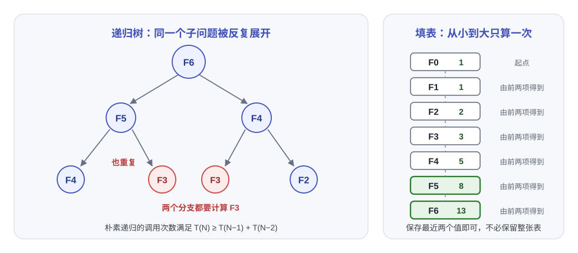
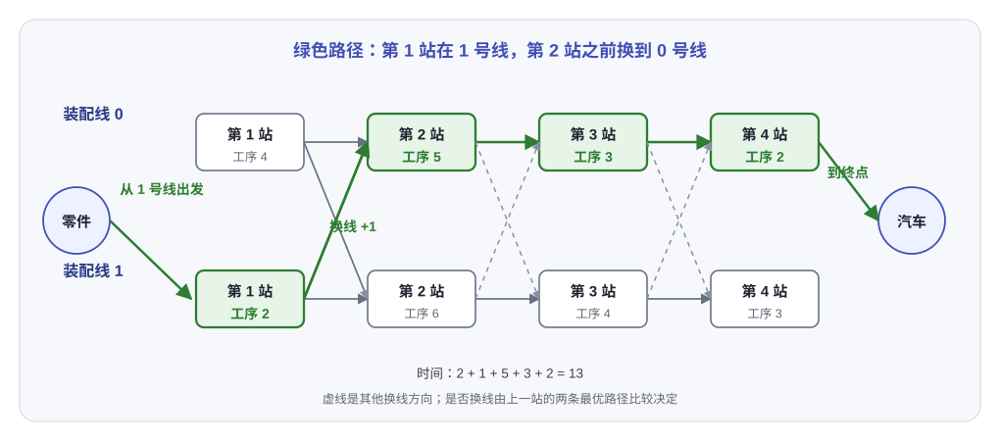

# 第七讲：动态规划（Dynamic Programming）

> 递归把问题拆小以后，常常会重复计算同一棵子树。动态规划（dynamic programming, DP）要解决的就是这件事：把每个不同的子问题只算一次，把结果存起来，再按依赖顺序拼出原问题。这一讲用斐波那契数列、矩阵链乘法、最优二叉搜索树、Floyd-Warshall 和装配线调度串起同一套设计步骤。

---

## 1. 基本思路（Dynamic Programming）

### 1.1 从重复递归说起

斐波那契数列（Fibonacci numbers）定义为

$$
F(0)=F(1)=1,
\qquad
F(N)=F(N-1)+F(N-2)\quad(N\ge 2).
$$

照着定义写成递归，代码很短：

```cpp
#include <iostream>

long long Fib(int N) {
    if (N <= 1) {
        return 1;
    }
    return Fib(N - 1) + Fib(N - 2);
}

int main() {
    std::cout << Fib(6) << '\n';  // 13
}
```

问题出在调用树。计算 `Fib(6)` 要算 `Fib(5)` 和 `Fib(4)`，而 `Fib(5)` 又要把 `Fib(4)` 算一遍；再往下，`Fib(3)` 会出现在好几个分支里。

<div style="overflow-x:auto; padding-bottom:0.5rem;">
  
</div>

窄屏时左右滑动看图：左边是重复的递归树，右边是从小到大填表。

图中的两个 `F3` 不是不同的子问题，输入完全相同，答案也完全相同。把 `F3` 算一次、记下来，后续分支直接取结果，重复工作就没了。

朴素递归满足

$$
T(N)\ge T(N-1)+T(N-2),
$$

所以调用次数至少和斐波那契数一样快地增长。它的精确量级是对数底为黄金比的指数，写代码时看到的递归树会很快翻倍。

> [!NOTE]
> **定义：动态规划**
>
> 用若干参数描述一个子问题，把每个不同状态的结果保存下来；状态转移只依赖已经算好的较小状态，最后从边界状态推到目标状态。

动态规划不要求原问题一定是“求最小值”或“求最大值”。斐波那契是计数，矩阵链是优化，Floyd-Warshall 是求距离，三者都可以用同一个框架。

### 1.2 两个关键性质

能用动态规划的问题通常要有两个性质：

- 最优子结构（optimal substructure）：原问题的最优解包含了某个子问题的最优解。矩阵链最优地切开以后，左右两段也必须按各自最优方式相乘，否则替换成更便宜的做法就能改进全局。
- 重叠子问题（overlapping subproblems）：不同递归分支会落到同一个状态。没有重叠时，普通分治即可；有重叠却不缓存，重复计算就会失控。

“子问题重叠”只是省时间的机会。要让状态转移合法，当前状态还必须包含影响后续决策的全部信息。这常被叫作无后效性：一旦走到某个状态，后面只看这个状态，不再关心它是从哪条具体路径来的。

比如装配线调度里，只知道“已经完成前 $s$ 站”还不够；还要知道最后停在哪条线上，因为下一步换线的时间不一样。状态少了这一维，转移式就写不出来。

### 1.3 四件事

一个动态规划解法通常可以拆成四件事：

| 要写清楚的内容 | 常见形式 | 检查点 |
|----------------|----------|--------|
| 状态 | `dp[i]`、`dp[i][j]`、`dp[l][s]` | 参数够不够，会不会把不同子问题混在一起 |
| 转移 | 从前一个状态取最大、最小，或枚举一个切分点 | 是否覆盖了所有决策，是否重复计数 |
| 边界与计算顺序 | 初值、空区间、从前到后、按区间长度 | 算当前状态时，依赖是否已经全部就绪 |
| 答案与还原 | `dp[1][N]`、`min(dp[0][N], dp[1][N])` | 只输出数值够不够，要不要保存决策 |

实现时有两条路：

- 记忆化递归（memoization）：按原递归写法，只把算过的状态存进数组或哈希表。适合状态稀疏、递推顺序不明显的情况。
- 填表（tabulation）：按拓扑顺序从小到大算。没有递归栈开销，也更容易做空间压缩。

两者算的是同一张状态图。填表的关键是顺序，不是把递归硬翻成一个三重循环。

### 1.4 和分治、贪心的区别

分治把问题拆成互不相交或可以独立处理的子问题，例如归并排序的左右两半。合并时只做一次。动态规划面对的是一张有汇合边的状态图，同一个子问题会从多条路径到达。

贪心每一步选当前看起来最好的候选，通常不会保留所有可能的前缀。局部最好不一定通向全局最好。最优二叉搜索树里按最高概率递归选根，得到 2.43 的期望访问时间；取中位数构造一棵高度平衡树，得到 2.70；真正的最佳值是 2.15。两个看起来合理的贪心思路都输给了保留多个子结构再比较。

---

## 2. 斐波那契数列（Fibonacci Numbers）

### 2.1 迭代填表

斐波那契的状态只有一个下标：

$$
F[i]=F[i-1]+F[i-2].
$$

转移只依赖前两项，所以不必保留整张表。保存 `F[i-1]` 和 `F[i-2]` 就够了。

```cpp
#include <iostream>

long long Fibonacci(int N) {
    if (N <= 1) {
        return 1;
    }

    long long last = 1;        // F(1)
    long long nextToLast = 1;  // F(0)
    for (int i = 2; i <= N; ++i) {
        long long answer = last + nextToLast;
        nextToLast = last;
        last = answer;
    }
    return last;
}

int main() {
    std::cout << Fibonacci(6) << '\n';  // 13
}
```

时间复杂度是 $O(N)$，额外空间是 $O(1)$。如果只做一次查询，这已经足够；如果后面还要多次取不同的 $F(N)$，保留整张表反而省得重复扫描。

### 2.2 为什么不能只写递推式

递归式说明“当前值由谁得到”，还没有说明“按什么顺序算”。`F[i]` 依赖 `i-1` 和 `i-2`，下标小的先算就满足依赖。把循环写成从大到小，读到的是尚未初始化的值。

动态规划题目里经常出现这类顺序错误。转移式看起来没问题，程序偶尔能跑，只是因为数组恰好被置了零。检查方法很直接：把每个状态的依赖箭头画出来，确认计算当前点时，所有箭头都指向已经完成的状态。

---

## 3. 矩阵链乘法（Matrix-Chain Multiplication）

### 3.1 括号不同，代价不同

矩阵乘法满足结合律，但不同的计算顺序会产生不同的标量乘法次数。若有四个矩阵

$$
M_1[10\times 20],
\,
M_2[20\times 50],
\,
M_3[50\times 1],
\,
M_4[1\times 100],
$$

先算右边：

$$
\begin{aligned}
M_1(M_2(M_3M_4))
&=50\cdot1\cdot100
+20\cdot50\cdot100
+10\cdot20\cdot100\\
&=125000.
\end{aligned}
$$

换一种括号：

$$
\begin{aligned}
((M_1(M_2M_3))M_4)
&=20\cdot50\cdot1
+10\cdot20\cdot1
+10\cdot1\cdot100\\
&=2200.
\end{aligned}
$$

矩阵没有变，结果矩阵也没有变，运算量差了五十多倍。

### 3.2 状态与转移

令 $M_{ij}=M_iM_{i+1}\cdots M_j$，$m_{ij}$ 表示算出这段矩阵乘积所需的最少标量乘法次数。单个矩阵不需要相乘：

$$
m_{ii}=0.
$$

当 $i<j$ 时，最后一次乘法一定把区间切成

$$
M_{ij}=M_{i\ell}M_{\ell+1,j},
\qquad i\le \ell<j.
$$

左边乘积的尺寸是 $r_{i-1}\times r_\ell$，右边是 $r_\ell\times r_j$，最后一次相乘需要 $r_{i-1}r_\ell r_j$ 次标量乘法。于是

$$
m_{ij}
=
\min_{i\le \ell<j}
\left\{
m_{i\ell}+m_{\ell+1,j}+r_{i-1}r_\ell r_j
\right\}.
$$

保存

$$
s_{ij}
=
\arg\min_{i\le\ell<j}
\left\{
m_{i\ell}+m_{\ell+1,j}+r_{i-1}r_\ell r_j
\right\}
$$

就能还原括号方案。

为什么左右两段可以直接取各自的最优值？假设某个最优切分把左边写成更便宜但不等价的非最优方案，整个乘积的代价会下降，与原方案最优矛盾。两段内部的乘法互不影响，这就是矩阵链问题的最优子结构。

### 3.3 按长度填表

$m_{ij}$ 依赖更短的区间，所以先算长度 2，再算长度 3，一直到长度 $N$。不能按 $i$ 从 1 扫到 $N$、$j$ 也从 1 扫到 $N$，因为长区间的依赖可能还没算。

上面四个矩阵的最小代价表如下：

| $i\backslash j$ | 1 | 2 | 3 | 4 |
|-----------------|---|---|---|---|
| 1 | 0 | 10000 | 1200 | 2200 |
| 2 |  | 0 | 1000 | 3000 |
| 3 |  |  | 0 | 5000 |
| 4 |  |  |  | 0 |

例如 $m_{14}$ 在 $\ell=1,2,3$ 中取最小值。最优切分是 $\ell=3$，所以

$$
M_{14}=M_{13}M_{44},
$$

而 $M_{13}$ 又要在 $\ell=1$ 处切开，最终得到 $((M_1(M_2M_3))M_4)$。

### 3.4 实现

下面用 0 基下标存矩阵尺寸。`r[i]` 是第 `i` 个矩阵的行数，`r[i + 1]` 是它的列数，相邻矩阵可以相乘。

```cpp
#include <iostream>
#include <limits>
#include <string>
#include <vector>
using namespace std;

string Parenthesize(int i, int j, const vector<vector<int>>& split) {
    if (i == j) {
        return "M" + to_string(i + 1);
    }
    int k = split[i][j];
    return "(" + Parenthesize(i, k, split) + " "
               + Parenthesize(k + 1, j, split) + ")";
}

int main() {
    vector<long long> r = {10, 20, 50, 1, 100};
    int n = static_cast<int>(r.size()) - 1;

    vector<vector<long long>> cost(n, vector<long long>(n, 0));
    vector<vector<int>> split(n, vector<int>(n, -1));

    for (int len = 2; len <= n; ++len) {
        for (int i = 0; i + len <= n; ++i) {
            int j = i + len - 1;
            cost[i][j] = numeric_limits<long long>::max();

            for (int k = i; k < j; ++k) {
                long long candidate =
                    cost[i][k] + cost[k + 1][j]
                    + r[i] * r[k + 1] * r[j + 1];

                if (candidate < cost[i][j]) {
                    cost[i][j] = candidate;
                    split[i][j] = k;
                }
            }
        }
    }

    cout << cost[0][n - 1] << '\n';              // 2200
    cout << Parenthesize(0, n - 1, split) << '\n';
    // ((M1 (M2 M3)) M4)
}
```

状态数是 $O(N^2)$。每个状态枚举 $O(N)$ 个切分点，总时间是 $O(N^3)$，空间是 $O(N^2)$。保存 `split` 不改变这个量级，不加它就只能输出最小代价，没法说明“按什么顺序乘”。

---

## 4. 最优二叉搜索树（Optimal Binary Search Tree）

### 4.1 问题

给定有序关键字

$$
w_1<w_2<\cdots<w_N,
$$

以及每个关键字的查找概率 $p_i$。如果 $w_i$ 的深度是 $d_i$，根结点深度为 0，那么一次查找的期望比较次数是

$$
T(N)=\sum_{i=1}^{N}p_i(1+d_i).
$$

要把高频词放浅，又不能破坏二叉搜索树（binary search tree, BST）的中序顺序，所以深度和顺序会一起限制树形。

本讲先不考虑查找失败的情况。失败查找还要求每隔两个相邻关键字放一个外部叶结点，转移式需要再加一层；思路相同，只是状态和边界更多。

课件给出的概率如下：

| word | break | case | char | do | return | switch | void |
|------|-------|------|------|----|--------|--------|------|
| probability | 0.22 | 0.18 | 0.20 | 0.05 | 0.25 | 0.02 | 0.08 |

概率之和为 1。

### 4.2 子问题与递推

设 $T_{ij}$ 是由 $w_i,\dots,w_j$ 构成的二叉搜索树，$c_{ij}$ 是它的最小期望访问代价，$r_{ij}$ 是选出的根。空树的代价规定为

$$
c_{i,i-1}=0.
$$

再记区间权重

$$
W_{ij}=\sum_{k=i}^{j}p_k.
$$

若根取 $w_\ell$，左子树是 $T_{i,\ell-1}$，右子树是 $T_{\ell+1,j}$。左右子树里的每个结点都往下移动一层，所以它们各自多贡献一次自己的概率；根本身贡献 $p_\ell$。这些新增项合起来正好是 $W_{ij}$，于是

$$
c_{ij}
=
W_{ij}
+
\min_{i\le \ell\le j}
\left(
c_{i,\ell-1}+c_{\ell+1,j}
\right).
$$

取到最小值的 $\ell$ 就是 $r_{ij}$。

这里最容易写错的是权重项。只在根结点加 $p_\ell$ 会漏掉“左右子树整体加深一层”的代价；更简单的看法是，当前区间内所有关键字都在当前子树里，各自至少被访问到一次，所以先加上区间总权重 $W_{ij}$，再递归选择左右子树。

### 4.3 填表

表中每个格子写成 `代价 / 根`。第一行按单词顺序排列，下方只填上三角。

| 起点 | break | case | char | do | return | switch | void |
|------|-------|------|------|----|--------|--------|------|
| break | 0.22 / break | 0.58 / break | 1.02 / case | 1.17 / case | 1.83 / char | 1.89 / char | 2.15 / char |
| case |  | 0.18 / case | 0.56 / char | 0.66 / char | 1.21 / char | 1.27 / char | 1.53 / char |
| char |  |  | 0.20 / char | 0.30 / char | 0.80 / return | 0.84 / return | 1.02 / return |
| do |  |  |  | 0.05 / do | 0.35 / return | 0.39 / return | 0.57 / return |
| return |  |  |  |  | 0.25 / return | 0.29 / return | 0.47 / return |
| switch |  |  |  |  |  | 0.02 / switch | 0.12 / void |
| void |  |  |  |  |  |  | 0.08 / void |

最终根是 `char`，最优树为

```text
char
├─ break
│  └─ case
└─ return
   ├─ do
   └─ void
      └─ switch
```

直接按概率从高到低递归选根，会先把 `return` 放上去，算出的期望访问时间是 2.43。取中位数作根得到的平衡树是 2.70。最优值 2.15 落在两者之间，左右子树的组合比单个结点的概率更重要。

### 4.4 实现要点

填表顺序仍然是区间长度从小到大：

```text
for len = 1 .. N:
    for i = 1 .. N - len + 1:
        j = i + len - 1
        W = prefix[j] - prefix[i - 1]
        c[i][j] = +infinity

        for root = i .. j:
            candidate = W
                      + cost(i, root - 1)
                      + cost(root + 1, j)
            if candidate < c[i][j]:
                c[i][j] = candidate
                r[i][j] = root
```

`cost(i, j)` 在 $i>j$ 时返回 0，用来处理空子树。实现时可以用一个多留一格边界的二维数组，或者写一个辅助函数，别让负下标读到别的状态。

朴素填表是 $O(N^3)$ 时间、$O(N^2)$ 空间。课件提到可以做到 $O(N^2)$；它利用最优根随区间扩展而单调的性质，减少每个状态的枚举范围。先把 $O(N^3)$ 版本写对更重要，因为这个问题的边界和权重比循环优化更容易出错。

---

## 5. 全源最短路径（All-Pairs Shortest Path）

### 5.1 两类做法

要从每个顶点 $v_i$ 到每个顶点 $v_j$ 求最短路径，一个直接办法是以每个顶点为源点，做一次单源最短路径（single-source shortest path）。

- 非负边权可以用堆优化 Dijkstra，稀疏图上是 $O(VE\log V)$；
- 有负边但没有负环时，可以用 Bellman-Ford，或者对所有点做 Johnson 算法；
- 图很稠密、边权可为负、需要一个小常数实现时，Floyd-Warshall 很直接，固定是 $O(V^3)$。

### 5.2 状态表示

把顶点编号为 $0,1,\dots,N-1$。定义 $D^{(k)}[i][j]$ 为从 $i$ 到 $j$、内部允许经过的顶点都在

$$
\{0,1,\dots,k\}
$$

中的最短路径长度。内部顶点不包括起点和终点。边界是没有任何内部顶点可用时：

$$
D^{(-1)}[i][j]=
\begin{cases}
\operatorname{cost}(i,j), & i\ne j,\\
0, & i=j.
\end{cases}
$$

如果有多条边，`cost(i, j)` 取最小权重；没有边就是 $+\infty$。

加入顶点 $k$ 后，最短路径只有两类：

- 不经过 $k$，长度仍是 $D^{(k-1)}[i][j]$；
- 经过 $k$，拆成 $i\to k$ 和 $k\to j$ 两段，内部都不能经过 $k$ 之后再绕回来。

第二类的长度是

$$
D^{(k-1)}[i][k]+D^{(k-1)}[k][j].
$$

因此

$$
D^{(k)}[i][j]
=
\min\left\{
D^{(k-1)}[i][j],
\,
D^{(k-1)}[i][k]+D^{(k-1)}[k][j]
\right\}.
$$

最终答案是 $D^{(N-1)}[i][j]$。

为什么只拆一次 $k$ 就够？如果最短路径多次经过 $k$，中间形成了一个从 $k$ 回到 $k$ 的环。没有负环时，去掉这个环不会让长度变大，所以总可以取一条只经过 $k$ 一次的最短路径。有负环时最短路径本身没有定义，递推也就失去意义。

### 5.3 原地更新

矩阵维度固定为 $N$，计算 $D^{(k)}$ 时只需要 $D^{(k-1)}$，所以可以原地覆盖。外层循环必须先固定 $k$：

```text
for (int k = 0; k < N; ++k) {
    for (int i = 0; i < N; ++i) {
        for (int j = 0; j < N; ++j) {
            if (dist[i][k] + dist[k][j] < dist[i][j]) {
                dist[i][j] = dist[i][k] + dist[k][j];
            }
        }
    }
}
```

如果 `dist[i][k]` 或 `dist[k][j]` 是无穷大，不要直接相加，否则可能溢出。常见做法是用 `INF / 4` 之类的有限值，并在相加前判断。

例如有两条路径

$$
A\to B=7,
\quad
A\to C=2,
\quad
C\to B=1.
$$

加入 $C$ 时，$D[A][B]$ 从 7 改为 $2+1=3$。如果还有 $C\to D=10$、$B\to D=3$，处理 $C$ 后先得到 $A\to D=12$，再处理 $B$ 时得到 $A\to B\to D=6$。每一轮只放开一个新的中间顶点，后面还能继续改进。

### 5.4 完整实现与路径还原

下面这段程序同时记录下一跳 `next[i][j]`。更新 `dist[i][j]` 时，新的最优路径先沿 $i\to k$ 走，所以下一跳改成 `next[i][k]`。

```cpp
#include <algorithm>
#include <iostream>
#include <limits>
#include <vector>
using namespace std;

int main() {
    const long long INF = numeric_limits<long long>::max() / 4;
    const int n = 4;

    vector<vector<long long>> dist(n, vector<long long>(n, INF));
    vector<vector<int>> next(n, vector<int>(n, -1));

    for (int i = 0; i < n; ++i) {
        dist[i][i] = 0;
        next[i][i] = i;
    }

    auto addEdge = [&](int u, int v, long long w) {
        if (w < dist[u][v]) {
            dist[u][v] = w;
            next[u][v] = v;
        }
    };

    addEdge(0, 1, 4);
    addEdge(0, 2, 1);
    addEdge(2, 1, 2);
    addEdge(1, 3, 1);
    addEdge(2, 3, 10);

    for (int k = 0; k < n; ++k) {
        for (int i = 0; i < n; ++i) {
            if (dist[i][k] == INF) {
                continue;
            }
            for (int j = 0; j < n; ++j) {
                if (dist[k][j] == INF) {
                    continue;
                }
                long long through = dist[i][k] + dist[k][j];
                if (through < dist[i][j]) {
                    dist[i][j] = through;
                    next[i][j] = next[i][k];
                }
            }
        }
    }

    cout << dist[0][3] << '\n';  // 4

    int target = 3;
    for (int cur = 0; cur != target; cur = next[cur][target]) {
        cout << cur << " -> ";
    }
    cout << target << '\n';  // 0 -> 2 -> 1 -> 3
}
```

如果某个 `dist[i][i] < 0`，说明存在从 $i$ 出发并回到 $i$ 的负权环。此时有些“最短路径”会因为不断绕环而无限变小，Floyd-Warshall 的结果不能再解释为最短距离。

原地版本的空间是 $O(N^2)$，时间是 $O(N^3)$。不能随意交换三个循环的顺序；把 $k$ 放进最内层，状态含义就变了。

---

## 6. 装配线调度（Assembly-Line Scheduling）

### 6.1 问题与状态

有一辆车依次经过 $N$ 个装配站。两条装配线都能完成同一组工序，但每条线在每个站的处理时间不同，站与站之间也可以换线。

记

- $a[\ell][s]$：第 $\ell$ 条线在第 $s$ 站的处理时间；
- $t[\ell][s]$：第 $s$ 站完成后，从第 $\ell$ 条线换到另一条线的转移时间；
- $f[\ell][s]$：前 $s$ 站全部完成，并且最终停在第 $\ell$ 条线第 $s$ 站时的最早时间。

第一站没有前置状态：

$$
f[\ell][1]=a[\ell][1].
$$

到了第 $s$ 站，路径要么上一站就在同一条线上，要么从另一条线换过来：

$$
f[\ell][s]
=
a[\ell][s]
+
\min
\left\{
f[\ell][s-1],
\,
f[1-\ell][s-1]+t[1-\ell][s-1]
\right\},
\qquad s\ge 2.
$$

如果题目还给了进入两条线的准备时间 $e_\ell$ 和离开两条线的收尾时间 $x_\ell$，把初值改成 $e_\ell+a[\ell][1]$，答案再取

$$
\min
\left(
f[0][N]+x_0,
\,
f[1][N]+x_1
\right).
$$

本讲用零准备、零收尾的版本，方便看清换线比较。

### 6.2 最优子结构

假设某个最优方案在完成第 $s$ 站后停在第 $\ell$ 条线。把前 $s-1$ 站取出来，它必须是到达对应上一站的最快方案。否则把前缀替换成更快的路径，再接上原来的第 $s$ 站，就能得到更短的完整方案，和“原方案最优”矛盾。

这一步只需要比较两个候选：留在原线，或者从另一条线换过来。枚举所有换线序列要 $O(2^N)$；动态规划保留了每个阶段的两条最优前缀，把选择压成了常数个。

<div style="overflow-x:auto; padding-bottom:0.5rem;">
  
</div>

窄屏时左右滑动看图，才能看到完整的四个工位和终点。

绿线表示这样一个方案：第 1 站在 1 号线，之后换到 0 号线，后面三站都不再换线。

### 6.3 完整例子

设 $N=4$，处理时间如下：

| 线 | 第 1 站 | 第 2 站 | 第 3 站 | 第 4 站 |
|----|---------|---------|---------|---------|
| 0 | 4 | 5 | 3 | 2 |
| 1 | 2 | 6 | 4 | 3 |

换线时间如下，`t[line][s]` 表示第 `s` 站之后从 `line` 换出去的时间：

| 线 | 第 1 站后 | 第 2 站后 | 第 3 站后 |
|----|-----------|-----------|-----------|
| 0 | 2 | 1 | 3 |
| 1 | 1 | 2 | 1 |

按站数推进：

| 已完成到 | 线 0 的时间 / 上一站 | 线 1 的时间 / 上一站 |
|----------|----------------------|----------------------|
| 第 1 站 | 4 / 无 | 2 / 无 |
| 第 2 站 | 8 / 线 1 | 8 / 线 1 |
| 第 3 站 | 11 / 线 0 | 12 / 线 1 |
| 第 4 站 | 13 / 线 0 | 15 / 线 1 |

第 4 站结束时取最小值：

$$
\min(13,15)=13.
$$

从 $(0,4)$ 沿着“上一站”向回走，得到 $(0,3)\to(0,2)\to(1,1)$，正对应图里的绿色路径。

### 6.4 实现与方案还原

除了保存时间，还要保存每个状态是“留在原线”还是“从另一条线换过来”。只保存时间只能得到最小值，无法说明实际应走哪条线。

```cpp
#include <array>
#include <iostream>
#include <limits>
#include <vector>
using namespace std;

struct Result {
    long long time;
    vector<int> line;  // line[s - 1] 是第 s 站所在的线
};

Result Solve(const vector<vector<int>>& processTime,
             const vector<vector<int>>& transferTime) {
    const int n = static_cast<int>(processTime[0].size()) - 1;
    const long long INF = numeric_limits<long long>::max() / 4;

    vector<array<long long, 2>> finish(n + 1, {INF, INF});
    vector<array<int, 2>> previous(n + 1, {-1, -1});

    finish[1][0] = processTime[0][1];
    finish[1][1] = processTime[1][1];

    for (int stage = 2; stage <= n; ++stage) {
        for (int line = 0; line < 2; ++line) {
            int other = 1 - line;

            long long stay =
                finish[stage - 1][line]
                + processTime[line][stage];

            long long move =
                finish[stage - 1][other]
                + transferTime[other][stage - 1]
                + processTime[line][stage];

            if (stay <= move) {
                finish[stage][line] = stay;
                previous[stage][line] = line;
            } else {
                finish[stage][line] = move;
                previous[stage][line] = other;
            }
        }
    }

    int lastLine = finish[n][0] <= finish[n][1] ? 0 : 1;
    Result answer{finish[n][lastLine], vector<int>(n)};

    int line = lastLine;
    for (int stage = n; stage >= 1; --stage) {
        answer.line[stage - 1] = line;
        if (stage > 1) {
            line = previous[stage][line];
        }
    }
    return answer;
}

int main() {
    vector<vector<int>> processTime = {
        {0, 4, 5, 3, 2},
        {0, 2, 6, 4, 3},
    };
    vector<vector<int>> transferTime = {
        {0, 2, 1, 3},
        {0, 1, 2, 1},
    };

    Result answer = Solve(processTime, transferTime);
    cout << answer.time << '\n';  // 13
    for (int line : answer.line) {
        cout << line << ' ';
    }
    cout << '\n';  // 1 0 0 0
}
```

时间推进本身是 $O(N)$，保存两层状态和决策是 $O(N)$ 空间。如果只问最小时间、不还原方案，计算下一站只用到上一站两条结果，可以压到 $O(1)$ 的额外空间。

---

## 7. 五种状态放在一起

| 问题 | 状态 | 决策或转移 | 答案 | 时间复杂度 | 空间复杂度 |
|------|------|------------|------|------------|------------|
| 斐波那契 | $F[i]$ | 前两项相加 | $F[N]$ | $O(N)$ | $O(1)$ |
| 矩阵链 | $m[i][j]$ | 枚举最后切分点 $\ell$ | $m[1][N]$ | $O(N^3)$ | $O(N^2)$ |
| 最优二叉搜索树 | $c[i][j]$ | 枚举根 $\ell$ | $c[1][N]$ | $O(N^3)$ | $O(N^2)$ |
| Floyd-Warshall | $D^{(k)}[i][j]$ | 不经过 $k$ 或经过 $k$ | $D^{(N-1)}$ | $O(V^3)$ | $O(V^2)$ |
| 装配线 | $f[\ell][s]$ | 留线或换线 | $\min_\ell f[\ell][N]$ | $O(N)$ | $O(N)$ |

这几题的共同点不是代码长得像，而是都在找一张有向无环的状态图。状态图一旦画对，初值、循环顺序和答案位置都会跟着确定。

遇到新题时，可以先写一个递归函数，问三个问题：

1. 调用参数里哪些值真正决定当前子问题？
2. 同一个参数组合会不会从多条路径到达？
3. 当前状态的结果依赖哪些更小或更早的状态？

前两个问题决定要不要存表，第三个问题决定按什么顺序填表。如果当前决策还取决于“从哪条路径走来”，说明状态少了信息，先补维度再写转移。

---

## 8. 课程项目（Research Project 4）

第四个研究项目叫 Red-black Tree (26)：恰好有 $N$ 个内部结点的不同红黑树（red-black tree）有多少棵。详细要求要在 [Pintia](https://pintia.cn/) 对应题目集里下载，课件本身只给了题目。

这类计数题适合用动态规划做，但只记“结点数 $N$”不够。左右子树都要满足红黑性质，父结点的颜色又限制孩子能不能是红色，所以状态通常至少还要包含黑高（black height）和根的颜色。

写递推前先确认三件事：

- “不同”是只看树形和颜色，还是也把关键字，或者空叶结点（NIL）的标号算进去；
- 黑高从根到空叶结点的黑结点数怎么计，根和 NIL 是否计入；
- 左右子树交换后，是同一个对象还是两个对象。

这些问题会改变状态和边界。先把计数口径固定，再写左右子树规模的分拆，否则很容易把同一种树算好几遍。

---

## 参考资料

1. 课程材料：第七讲动态规划课件，例题数据取自 Fibonacci Numbers、Ordering Matrix Multiplications、Optimal Binary Search Tree、All-Pairs Shortest Path 和 Product Assembly 五组幻灯片。
2. M. A. Weiss, *Data Structure and Algorithm Analysis in C* (2nd Edition): Ch.10（算法设计技巧，矩阵链乘法、最优二叉搜索树、全源最短路径和动态规划例题）。
3. T. H. Cormen, C. E. Leiserson, R. L. Rivest, C. Stein, *Introduction to Algorithms* (3rd Edition): Ch.15（p.359–413，动态规划）。
4. 正文补充：斐波那契迭代写法、五个完整 C++ 程序、贪心与平衡树的期望访问时间比较，以及装配线调度的四站算例。代码和表格数值均已逐项运行或手算核对。
