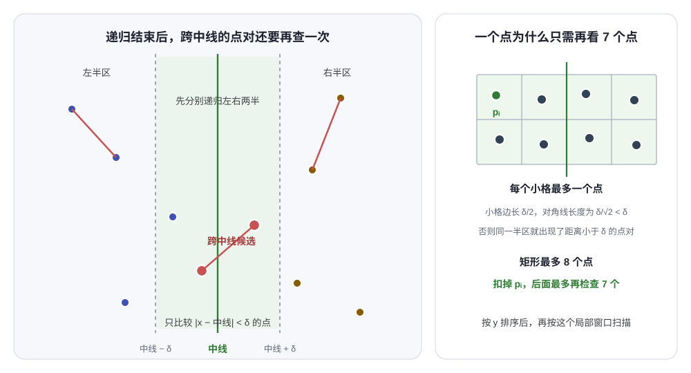

# 第七讲：分治、最近点对与递归式（Divide and Conquer and Recurrences）

> 分治看起来只是“把问题砍成两半”，真正决定复杂度的是递归以后怎么合并。最近点对问题会把这一点摆得很清楚：左右两半分别算完之后，还要在线性的时间内检查跨中线的一窄条，整体才能做到 $O(N\log N)$。后半讲接着处理所有分治算法都绕不开的递归式，包括代入法、递归树和主定理。

---

## 1. 分治框架（Divide and Conquer）

### 1.1 分、治、合

分治（divide and conquer）处理一个问题时，把它拆成若干个规模更小的同类问题，递归求这些子问题，再把结果合成原问题的答案。规模小到可以直接处理时到达基本情况（base case）。

三个动作分别是：

- 分解（divide）：把输入切成若干子问题。
- 解决（conquer）：递归求解子问题。
- 合并（combine）：把子问题的答案拼成当前问题的答案。

如果每层都切成 $b$ 份，只递归其中 $a$ 份，合并代价记作 $f(N)$，就得到最常见的递归式（recurrence）

$$
T(N)=aT(N/b)+f(N).
$$

这里的 $a,b$ 不一定相等，子问题也不一定严格等大。归并排序恰好分成两个 $N/2$ 的子问题，`closest pair` 也采用左右各一半的划分。快速排序的切分点由枢轴（pivot）决定，两个子问题的大小就随输入变化；它的平均分析会得到类似的分治结构，最坏情况却退化成 $O(N^2)$。

课件用下面几类问题说明分治的适用范围：

| 问题 | 分解方式 | 合并工作 | 典型时间 |
|------|----------|----------|----------|
| 最大连续子序列和 | 左右两半，另查跨中线的一段 | $O(N)$ | $O(N\log N)$ |
| 树的遍历 | 根和若干子树 | 每个结点常数次 | $O(N)$ |
| 归并排序 | 左右两半 | 线性归并 | $O(N\log N)$ |
| 快速排序 | 按枢轴切分 | 线性划分 | 平均 $O(N\log N)$，最坏 $O(N^2)$ |
| 最近点对 | 按 $x$ 坐标分左右 | 检查窄带 | $O(N\log N)$ |

能把问题切开，不代表分治一定更快。如果合并要枚举左右两边所有组合，分治的代价可能退回到平方级。最近点对的难点正好在合并：直接检查左右之间所有点仍然是 $O(N^2)$，必须证明窄带里只需要看很少几个邻居。

### 1.2 先分清“切得动”和“合得回来”

一个分治算法至少要有两个条件：

1. 子问题和原问题是同一种问题，可以继续递归。
2. 子问题的答案足以组成原问题的答案，并且组合过程比穷举全部候选便宜。

第二个条件经常被忽略。子问题内部即使都求到了最优值，如果合并时漏掉了跨越边界的可能性，答案还是错的。最近点对的最终答案可能在左半区，也可能在右半区，还可能一边取一个点。前两类交给递归，第三类必须在合并阶段补上。

分治也要求子问题之间的处理相对独立。如果两个子问题大量共享状态、反复计算相同结果，动态规划（dynamic programming）通常更合适；这部分放到第八讲。

---

## 2. 最近点对（Closest Pair of Points）

### 2.1 问题与朴素做法

给定平面上的 $N$ 个点，找出距离最近的一对点。点 $P_i=(x_i,y_i)$ 和 $P_j=(x_j,y_j)$ 的欧氏距离（Euclidean distance）是

$$
d(P_i,P_j)
=
\sqrt{(x_i-x_j)^2+(y_i-y_j)^2}.
$$

如果两个点位置完全相同，最近距离就是 0，而且不必再找别的点对。

枚举所有点对一共有

$$
\binom N2=\frac{N(N-1)}2
$$

对，每一对做一次常数时间的距离计算，因此时间复杂度是 $\Theta(N^2)$，额外空间只需要保存当前最优值。

### 2.2 左右递归与跨中线检查

先把所有点按 $x$ 坐标排序，再按排序后的位置从中间切成左右两半。设左半区递归求出的最近距离为 $d_L$，右半区为 $d_R$，记

$$
\delta=\min(d_L,d_R).
$$

左半区内部和右半区内部不可能再有比 $\delta$ 更近的点对，否则递归会返回更小的值。真正没检查过的只剩一边一个点的点对。

如果跨中线的两点距离小于 $\delta$，它们的 $x$ 坐标都离中线不到 $\delta$。于是只需检查宽度为 $2\delta$ 的窄带（strip）：

$$
\lvert x-\text{中线}\rvert<\delta.
$$

窄带里的点再按 $y$ 坐标排序。对某个点 $P_i$，后续点只要满足

$$
y_j-y_i\ge\delta,
$$

它和后面所有点的纵向差都更大，就可以直接停止这一轮比较。

这一步看起来仍有风险。如果 $N$ 个点全挤在窄带里，双重循环不是又要比较 $O(N^2)$ 对吗？

### 2.3 每个点最多比较 7 个后续点

对窄带中的任意点 $P_i$，只考虑纵坐标位于 $[y_i,y_i+\delta)$ 内的点。这些点同时落在宽度为 $2\delta$ 的区间里，因此都被装进一个宽 $2\delta$、高 $\delta$ 的矩形。

把这个矩形切成 8 个边长为 $\delta/2$ 的小正方形，每半边两列。任何一个正方形里的两个点都在同一个半区，距离至多为对角线长度

$$
\sqrt{\left(\frac\delta2\right)^2+\left(\frac\delta2\right)^2}
=
\frac{\delta}{\sqrt2}
<
\delta.
$$

这与“同一半区里任意两点距离都不小于 $\delta$”矛盾。所以每个小正方形最多有一个点，整个矩形最多有 8 个点。这里已经包含 $P_i$，它后面最多只剩 7 个点需要比较。

<div style="overflow-x:auto; padding-bottom:0.5rem;">
  
</div>

窄屏时左右滑动看图。左图是划分后的点集。左右两半先各自递归，窄带里的红色点对才需要额外检查。右图把“最多再看 7 个点”变成了一个打包问题：宽 $2\delta$、高 $\delta$ 的矩形正好分成 $4\times2$ 个小格，每个小格最多放一个点。绿点是被扫描的 $P_i$，同一行后面最多还有 7 个候选。

这条结论成立的关键是 $\delta$ 来自左右两半内部的最小距离。如果拿一个随便的宽度去切矩形，小格里的两点距离可能小于参考值，打包引理就不成立了。

课件还提到过一种容易误判的情况：如果已经知道 `NumPointInStrip = O(sqrt(N))`，直接枚举窄带点对也只要 $O(N)$；但最坏情况下窄带里可以有 $N$ 个点，所以必须利用按 $y$ 排序后的 7 点上界。

### 2.4 为什么最终是 $O(N\log N)$

窄带扫描本身是线性的，但每个递归结点还需要得到按 $y$ 排序的窄带。实现方式不同，复杂度也不同。

如果在每一层都重新排序窄带：

$$
T(N)=2T(N/2)+O(N\log N),
$$

递归树每一层大约增加 $N\log N$ 的工作，总时间是 $O(N\log^2 N)$。

如果在递归前先按 $x$ 排一次、按 $y$ 排一次，再把按 $y$ 排好的点列沿左右两边分给子递归，当前层只需要线性扫描。递归式变成

$$
T(N)=2T(N/2)+O(N),
$$

由主定理第二类得到

$$
T(N)=\Theta(N\log N).
$$

下面的实现采用第二种做法。`px` 始终按 $x$ 排好；每次递归收到的 `py` 是当前区间内按 $y$ 排好的下标。拆成 `leftY` 和 `rightY` 需要线性时间，窄带扫描也是线性时间。

```cpp
#include <algorithm>
#include <cmath>
#include <iomanip>
#include <iostream>
#include <limits>
#include <vector>

struct Point {
    long double x;
    long double y;
};

long double SquaredDistance(const Point& a, const Point& b) {
    const long double dx = a.x - b.x;
    const long double dy = a.y - b.y;
    return dx * dx + dy * dy;
}

long double BruteForce(const std::vector<Point>& px, int left, int right) {
    long double best = std::numeric_limits<long double>::infinity();
    for (int i = left; i < right; ++i) {
        for (int j = i + 1; j < right; ++j) {
            best = std::min(best, SquaredDistance(px[i], px[j]));
        }
    }
    return best;
}

long double ClosestRecursive(
    const std::vector<Point>& px,
    const std::vector<int>& py,
    int left,
    int right) {
    if (right - left <= 3) {
        return BruteForce(px, left, right);
    }

    const int middle = (left + right) / 2;
    std::vector<int> leftY;
    std::vector<int> rightY;
    leftY.reserve(middle - left);
    rightY.reserve(right - middle);

    for (int index : py) {
        if (index < middle) {
            leftY.push_back(index);
        } else {
            rightY.push_back(index);
        }
    }

    long double best = std::min(
        ClosestRecursive(px, leftY, left, middle),
        ClosestRecursive(px, rightY, middle, right)
    );
    if (best == 0.0L) {
        return 0.0L;
    }

    const long double delta = std::sqrt(best);
    const long double middleX = px[middle].x;
    std::vector<int> strip;
    strip.reserve(right - left);

    for (int index : py) {
        if (std::fabs(px[index].x - middleX) < delta) {
            strip.push_back(index);
        }
    }

    for (int i = 0; i < static_cast<int>(strip.size()); ++i) {
        for (int j = i + 1; j < static_cast<int>(strip.size()); ++j) {
            const long double dy = px[strip[j]].y - px[strip[i]].y;
            if (dy * dy >= best) {
                break;
            }
            best = std::min(
                best,
                SquaredDistance(px[strip[i]], px[strip[j]])
            );
        }
    }

    return best;
}

long double ClosestPair(std::vector<Point> points) {
    if (points.size() < 2) {
        return std::numeric_limits<long double>::infinity();
    }

    std::sort(points.begin(), points.end(), [](const Point& a, const Point& b) {
        if (a.x != b.x) {
            return a.x < b.x;
        }
        return a.y < b.y;
    });

    // 重合点会让最近距离变成 0。先检查，避免递归把 0 当成无穷小宽度。
    for (int i = 1; i < static_cast<int>(points.size()); ++i) {
        if (points[i].x == points[i - 1].x && points[i].y == points[i - 1].y) {
            return 0.0L;
        }
    }

    const int n = static_cast<int>(points.size());
    std::vector<int> sortedY(n);
    for (int i = 0; i < n; ++i) {
        sortedY[i] = i;
    }
    std::sort(sortedY.begin(), sortedY.end(), [&](int i, int j) {
        return points[i].y < points[j].y;
    });

    return std::sqrt(ClosestRecursive(points, sortedY, 0, n));
}

int main() {
    std::vector<Point> points = {
        {-3, 4}, {2, 0}, {-3, -1},
        {3, 0}, {8, 4}, {8, -1}
    };

    std::cout << std::fixed << std::setprecision(3)
              << ClosestPair(points) << '\n';  // 1.000
}
```

样例的左右两半各自最近距离都是 5，跨中线却存在

$$
d((2,0),(3,0))=1,
$$

所以只看 $d_L$ 和 $d_R$ 会漏掉正确答案。

### 2.5 正确性

对区间长度做归纳。基本情况直接枚举，显然正确。

递归返回 $\delta$ 后，如果最终最近点对在左半区或右半区，由归纳假设已经找到。如果它跨越中线，那么两个点都在窄带中，并且纵坐标差小于 $\delta$。按 $y$ 排序扫描时，较小纵坐标的点会把它放进候选窗口；由于窗口里最多只有 7 个后续点，不会被提前截断。

因此所有点对都被覆盖，递归返回的正好是全局最小距离。

浮点数上的“重合”和“距离等于 $\delta$”需要提前约定。程序里用严格 `< delta` 判断窄带，用 `>=` 决定截断，和证明里的开闭边界一致。若实际数据是近似坐标，还要先确定重合点是否按误差判定，不能只在最近点对算法里随手加一个 `eps`，否则正确性会依赖输入尺度。

---

## 3. 递归式怎么读（Recurrences）

递归式描述算法在规模 $N$ 上花的时间。例如

$$
T(N)=2T(N/2)+cN
$$

表示分成两个半规模子问题，再做 $cN$ 的合并工作。

课件列出三种常用方法：

| 方法 | 主要用途 | 得到答案的方式 |
|------|----------|----------------|
| 代入法（substitution method） | 已经猜到形式，需要严格证明 | 数学归纳 |
| 递归树（recursion-tree method） | 观察每层成本，辅助猜答案 | 展开树并求和 |
| 主定理（master theorem） | 标准的等比例分治递归式 | 比较合并代价与叶层规模 |

后面统一忽略两件细节：

- $N/b$ 能不能整除，把 $\lfloor N/b\rfloor$ 和 $\lceil N/b\rceil$ 当成 $N/b$。
- 小规模输入一律假设 $T(n)=\Theta(1)$。

这两种省略在渐近分析里通常安全。前提是分治递归保持正常的常数比例，不能一会儿切掉近乎全部输入，一会儿只减少一个元素。那种不平衡变化需要单独分析。

---

## 4. 代入法（Substitution Method）

### 4.1 先猜，再用归纳证

代入法分两步：先猜一个解的形式，再把它代进递归式，用数学归纳法证明。

以归并排序的递归式为例：

$$
T(N)=2T(\lfloor N/2\rfloor)+N.
$$

猜

$$
T(N)=O(N\log N).
$$

严格写出来，要证明存在常数 $c>0$ 和 $N_0$，使得所有 $N\ge N_0$ 都有

$$
T(N)\le cN\log N.
$$

假设对所有小于 $N$ 的规模都成立，于是

$$
\begin{aligned}
T(N)
&=2T(\lfloor N/2\rfloor)+N\\
&\le 2c\lfloor N/2\rfloor\log\lfloor N/2\rfloor+N\\
&\le cN(\log N-1)+N\\
&=cN\log N+(1-c)N\\
&\le cN\log N
\qquad(c\ge1).
\end{aligned}
$$

这和课件里的推导是同一个意思，只是把 $c\ge1$ 的条件留在了最后。

难点通常不在归纳步，而在基本情况。这里的证明从 $N=2$ 和 $N=3$ 开始比较方便，因为 $\log 1=0$，把 $N=1$ 直接代入会得到一个没有信息的不等式。先验证两个小规模，再让常数 $c$ 大到同时覆盖它们，归纳就能从 $2,3$ 往上走。

### 4.2 猜错时，归纳会卡住

对同一个递归式，如果猜

$$
T(N)=O(N),
$$

并假设

$$
T(\lfloor N/2\rfloor)\le c\lfloor N/2\rfloor,
$$

代入后得到

$$
\begin{aligned}
T(N)
&\le 2c\lfloor N/2\rfloor+N\\
&\le cN+N\\
&=(c+1)N.
$$

这不是

$$
T(N)\le cN
$$

所要求的形式。换成另一个常数 $d$，只会得到 $d+1$，差值仍然累积。

这里的错误不是“$c$ 取得不够大”。猜想本身少了 $\log N$ 这一层，递归展开时总会多出一整层的线性成本。

再举一个简单的例子：

$$
T(N)=T(N/2)+1.
$$

猜 $T(N)=O(\log N)$。归纳假设 $T(N/2)\le c\log(N/2)$，代入得

$$
T(N)\le c\log N-c+1\le c\log N
\qquad(c\ge1).
$$

这次猜想和每层只增加常数的工作量对得上。

代入法需要把 $O$ 展开成带常数的不等式。只在推导末尾写一个 $O$，再把 $cN+N$ 直接说成 $O(N)$，严格来说证明的是“原式确实是 $O(N)$”这件循环论证，并没有完成归纳。

---

## 5. 递归树（Recursion Tree）

### 5.1 平衡的递归树

考虑

$$
T(N)=3T(N/4)+\Theta(N^2).
$$

根结点的代价是 $cN^2$。它有三个孩子，每个规模为 $N/4$，所以第一层内部结点的总代价是

$$
3c\left(\frac N4\right)^2
=
\frac{3}{16}cN^2.
$$

第 $i$ 层有 $3^i$ 个结点，每个规模是 $N/4^i$，总代价为

$$
3^i c\left(\frac N{4^i}\right)^2
=
\left(\frac{3}{16}\right)^i cN^2.
$$

每层成本按 $3/16$ 缩小，整个非叶层加起来不超过

$$
\sum_{i=0}^{\infty}\left(\frac{3}{16}\right)^i cN^2
=
\frac{cN^2}{1-3/16}.
$$

树的深度是 $\log_4 N$，叶子数是

$$
3^{\log_4 N}=N^{\log_4 3}.
$$

因为

$$
\log_4 3\approx0.792<2,
$$

叶层代价低于 $\Theta(N^2)$。根结点本身已经贡献了 $\Theta(N^2)$，所以

$$
T(N)=\Theta(N^2).
$$

递归树给出的直觉是：合并代价从根往下缩得足够快，最上面一层就主导了总和。

### 5.2 不平衡的递归树

课件还分析了

$$
T(N)=T(N/3)+T(2N/3)+cN.
$$

这不是标准主定理形式，因为两个子问题的规模不同。树的最短路径一直走 $N/3$ 分支，长度是 $\log_3 N$；最长路径一直走 $2N/3$ 分支，长度是 $\log_{3/2}N$。

先用代入法证明上界。猜

$$
T(N)\le dN\log N.
$$

代入可得

$$
\begin{aligned}
T(N)
&\le
d\frac N3\log\frac N3
+d\frac{2N}3\log\frac{2N}3
+cN\\
&=
dN\log N
-dN\left(\log3-\frac23\log2\right)
+cN.
\end{aligned}
$$

其中的系数

$$
\alpha=\log3-\frac23\log2>0.
$$

只要取

$$
d\ge\frac c\alpha,
$$

就有

$$
T(N)\le dN\log N.
$$

所以 $T(N)=O(N\log N)$。

课件到这一步只做了上界，树也标了 “Not complete”。下界可以从树的前几层直接看出来。只要

$$
j\le\lfloor\log_3 N\rfloor,
$$

第 $j$ 层每个结点的规模至少是 $N/3^j\ge1$，这棵树还没有触底。此层所有结点的规模之和正好是 $N$，因为每次分裂只是把父结点的规模拆成 $N/3$ 和 $2N/3$。因此前 $\lfloor\log_3N\rfloor$ 层每层的总工作都是 $cN$，单是这些层就有

$$
\Omega(N\log N)
$$

的下界。上下界合起来得到

$$
T(N)=\Theta(N\log N).
$$

### 5.3 多出一层对数

考虑

$$
T(N)=2T(N/2)+N\log N.
$$

为了看清求和，先取 $N=2^m$。根结点代价是 $Nm$。下一层有两个 $N/2$ 规模的结点，每个增加 $(N/2)(m-1)$，合计又是 $N(m-1)$。

第 $i$ 层的总代价是

$$
N(m-i).
$$

从 $i=0$ 加到 $i=m-1$，得到

$$
N(1+2+\cdots+m)
=
\Theta(N\log^2 N).
$$

> [!WARNING]
> 课件第 12 页在 $a=b=2,\ f(N)=N\log N$ 的例子后面写成了 $O(N\log N)$，第 16 页的简化主定理则给出 $O(N\log^2 N)$。后者是正确的；用递归树逐层求和，或者用代入法猜 $dN\log^2N$，都能得到 $\Theta(N\log^2N)$。这个递归式超出了标准主定理三种情形的边界，所以页面上用了问号，不能把它套进第二类。

---

## 6. 主定理（Master Theorem）

### 6.1 标准形式

设 $a\ge1$、$b>1$ 是常数，递归式为

$$
T(N)=aT(N/b)+f(N).
$$

令

$$
p=\log_b a.
$$

主定理比较的是 $f(N)$ 和 $N^p$，而不是 $f(N)$ 和 $N$。

> [!NOTE]
> **主定理（Master Theorem）**
>
> 1. 如果存在常数 $\varepsilon>0$，使 $f(N)=O(N^{p-\varepsilon})$，则
>    $$
>    T(N)=\Theta(N^p).
>    $$
>
> 2. 如果 $f(N)=\Theta(N^p)$，则
>    $$
>    T(N)=\Theta(N^p\log N).
>    $$
>
> 3. 如果存在常数 $\varepsilon>0$，使 $f(N)=\Omega(N^{p+\varepsilon})$，并且存在常数 $c<1$，使对所有足够大的 $N$ 都有
>    $$
>    af(N/b)\le cf(N),
>    $$
>    则
>    $$
>    T(N)=\Theta(f(N)).
>    $$

第二类里，合并代价和叶层 $N^p$ 同阶，每一层都贡献 $\Theta(N^p)$，一共 $\Theta(\log N)$ 层。

第一类和第三类都要求“多项式级别”的差距。只说 $f(N)$ 比 $N^p$ 小或大，不够。

### 6.2 第一类为什么由根主导

把递归树按层展开。第 $j$ 层有 $a^j$ 个结点，每个规模为 $N/b^j$，总代价为

$$
a^jf(N/b^j).
$$

如果

$$
f(N)=O(N^{p-\varepsilon}),
$$

那么第 $j$ 层的成本至多为

$$
\begin{aligned}
a^j\left(\frac N{b^j}\right)^{p-\varepsilon}
&=
N^{p-\varepsilon}
\left(\frac{a}{b^{p-\varepsilon}}\right)^j\\
&=
N^{p-\varepsilon}(b^\varepsilon)^j.
\end{aligned}
$$

对各层求和：

$$
\begin{aligned}
\sum_{j=0}^{\log_bN-1}O\left(N^{p-\varepsilon}(b^\varepsilon)^j\right)
&=
O\left(N^{p-\varepsilon}\cdot N^\varepsilon\right)\\
&=
O(N^p).
$$

叶层一共有

$$
a^{\log_bN}=N^{\log_ba}=N^p
$$

个结点，代价也是 $O(N^p)$。根结点又有 $f(N)$ 的代价，而它比 $N^p$ 低一个多项式因子，因此上下合起来仍然是

$$
T(N)=\Theta(N^p).
$$

第三类比较直观：如果每层的合并成本按至少 $N^\varepsilon$ 的速度增长，递归树最底下的成本会主导总和。额外的正则条件（regularity condition）

$$
af(N/b)\le cf(N)
$$

保证“下一层成本不超过当前层的常数倍”，不会出现某些层突然增长、导致几何级数失效的情况。

### 6.3 简化形式

课程里还给了一个更适合考试的版本：

$$
T(N)=aT(N/b)+\Theta(N^k\log^pN),
\qquad
a\ge1,\ b>1,\ p\ge0.
$$

令叶层的数量级为

$$
N^{\log_ba},
$$

再和合并项里的 $N^k$ 比较：

| 比较结果 | 解 |
|----------|----|
| $a>b^k$ | $\Theta(N^{\log_ba})$ |
| $a=b^k$ | $\Theta(N^k\log^{p+1}N)$ |
| $a<b^k$ | $\Theta(N^k\log^pN)$ |

几个常考点：

- 归并排序 $a=b=2$，$k=1$，$p=0$，属于 $a=b^k$，得到 $\Theta(N\log N)$。
- 每次分三份、只递归两份，合并线性，即 $T(N)=3T(N/2)+\Theta(N)$。这里 $3>2^1$，得到 $\Theta(N^{\log_23})\approx\Theta(N^{1.585})$。
- 同样分三份，但合并要 $\Theta(N^2)$，即 $3<2^2$，得到 $\Theta(N^2)$。
- $T(N)=2T(N/2)+\Theta(N\log N)$，属于 $a=b^k$ 且 $p=1$，得到 $\Theta(N\log^2N)$。

课件第 15 页还用层成本的比例给出速记：

$$
a f(N/b)
\begin{cases}
<\kappa f(N),& \kappa<1,\\
>K f(N),& K>1,\\
=f(N),
\end{cases}
$$

分别对应“根主导”“叶层主导”“每层同阶”。这个说法在比例能保持为常数时很好用，但标准主定理给的条件更稳。遇到 $f(N)=N\log N$ 这种刚好夹在多项式级别之间的函数，比例形式可能一直趋近于 1，不能只靠大小关系下结论。

### 6.4 不适用的例子

下面这些递归式不能直接套标准主定理：

- $T(N)=2T(N/2)+N\log N$。合并项只比 $N$ 多一个对数因子，不是多项式级别更大。
- $T(N)=2T(N/2)+N/\log N$。合并项也只比 $N$ 少一个对数因子。
- $T(N)=T(N/3)+T(2N/3)+N$。两个子问题的规模不同，不是 $aT(N/b)$ 的形式。

这些式子仍然可以用递归树、代入法，或者更一般的 Akra-Bazzi 方法求解。主定理不是所有递归式的万能公式。

---

## 7. 补充：矩阵乘法的递归展开

这一节来自课件列出的 *Introduction to Algorithms* 第 4 章，用来看看主定理怎样解释一个真实的算法改进。

把两个 $N\times N$ 矩阵按中线分成四个 $N/2\times N/2$ 子矩阵。普通分块乘法需要 8 次子矩阵乘法和常数次子矩阵加法，递归式为

$$
T_{\mathrm{naive}}(N)
=
8T(N/2)+\Theta(N^2).
$$

因为 $\log_2 8=3$，合并项 $N^2$ 比 $N^3$ 小一个多项式因子，所以

$$
T_{\mathrm{naive}}(N)=\Theta(N^3).
$$

Strassen 算法把 8 次子矩阵乘法压到 7 次，代价是增加若干次加减法。加减法每层仍然是 $\Theta(N^2)$，递归式变成

$$
T_{\mathrm{Strassen}}(N)
=
7T(N/2)+\Theta(N^2).
$$

此时

$$
T_{\mathrm{Strassen}}(N)
=
\Theta(N^{\log_27})
\approx
\Theta(N^{2.807}).
$$

只少了 1 次乘法，指数就从 3 降到了 $\log_27$。递归树里，7 次乘法每次继续展开，叶结点数量是

$$
7^{\log_2N}=N^{\log_27}.
$$

这项改进的代价是实现更复杂、常数更大，而且标量加法也要计入。渐近阶更低不代表所有输入规模上一定更快。

---

## 8. 方法对比与检查清单

### 8.1 三种方法放在一起

| 方法 | 什么时候用 | 优点 | 常见错误 |
|------|------------|------|----------|
| 代入法 | 已经有合理猜测，或者主定理不适用 | 能证明严格上界、下界 | 猜错形式；漏基本情况；把 $O$ 当成常数 |
| 递归树 | 需要观察各层成本 | 容易看出主导层 | 只画树不求和；忽略叶层 |
| 主定理 | 标准等比例分治 | 计算快 | 拿 $f(N)$ 和 $N$ 比；忽略 $\varepsilon$ 和正则条件 |

做题时可以按下面的顺序检查：

1. 先看递归式是不是 $aT(N/b)+f(N)$。规模不按固定比例切时，先别套主定理。
2. 计算 $p=\log_ba$，把 $f(N)$ 和 $N^p$ 比较，而不是和 $N$ 比较。
3. 如果恰好是 $N^k\log^pN$，可以直接用简化表。
4. 如果主定理不适用，画两三层递归树，猜一个形式，再用代入法证明。
5. 上界和下界都要能说出来。主定理通常直接给 $\Theta$，代入法常常先得到一个方向。

### 8.2 几个快速例子

| 递归式 | 关键比较 | 结果 |
|--------|----------|------|
| $T(N)=4T(N/2)+N$ | $4>2^1$ | $\Theta(N^2)$ |
| $T(N)=4T(N/2)+N^2$ | $4=2^2$ | $\Theta(N^2\log N)$ |
| $T(N)=4T(N/2)+N^3$ | $4<2^3$ | $\Theta(N^3)$ |
| $T(N)=2T(N/2)+N$ | $2=2^1$ | $\Theta(N\log N)$ |
| $T(N)=2T(N/2)+N^2$ | $2<2^2$ | $\Theta(N^2)$ |
| $T(N)=3T(N/4)+N^2$ | $3<4^2$，递归树也显示根主导 | $\Theta(N^2)$ |
| $T(N)=T(N/3)+T(2N/3)+N$ | 子问题不均等 | $\Theta(N\log N)$ |
| $T(N)=2T(N/2)+N\log N$ | 主定理不适用 | $\Theta(N\log^2N)$ |

对数底数不影响渐近结果。$\log_2N$、$\ln N$ 和 $\log_{10}N$ 只差一个常数因子；但 $N^{\log_ba}$ 里的底数 $b$ 会影响指数，不能随便换。

---

## 参考资料

1. 课程材料：第七讲分治课件。最近点对、三种递归式求解方法、主定理以及课件中的反例均取自该课件。
2. M. A. Weiss, *Data Structure and Algorithm Analysis in C* (2nd Edition): Ch.10，p.365–372。用于补充分治的递归分析、最近点对的实现细节和 7 点打包证明。
3. T. H. Cormen, C. E. Leiserson, R. L. Rivest, C. Stein, *Introduction to Algorithms* (3rd Edition): Ch.4，p.65–113。用于补充代入法、递归树、主定理的严格表述和矩阵乘法。
4. Jeff Erickson, *CS 373: Combinatorial Algorithms*, “Notes on Solving Recurrence Relations”，p.10–13。用于对照主定理和递归式示例。
5. 正文补充：最近点对的完整 C++ 实现与六点样例、宽 $2\delta$、高 $\delta$ 的打包证明、非平衡递归树的下界推导、矩阵乘法的复杂性比较。代码和样例输出已实际编译运行。
