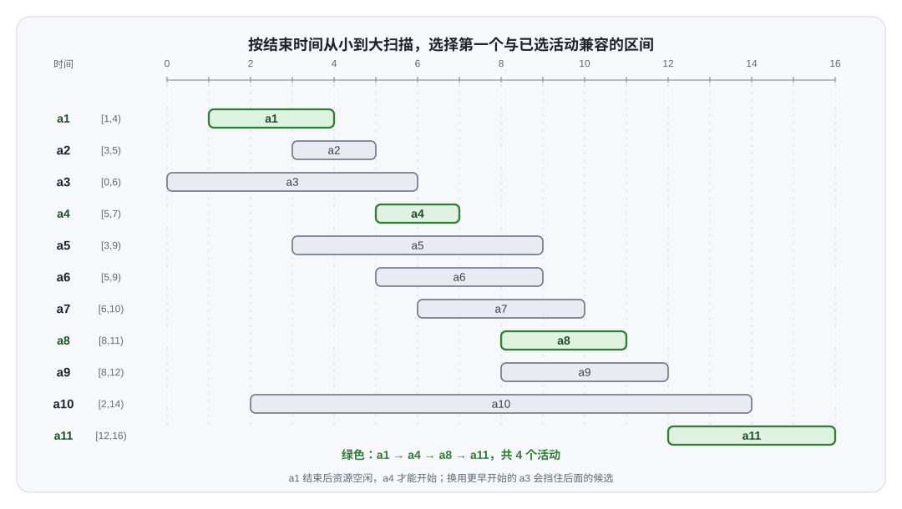
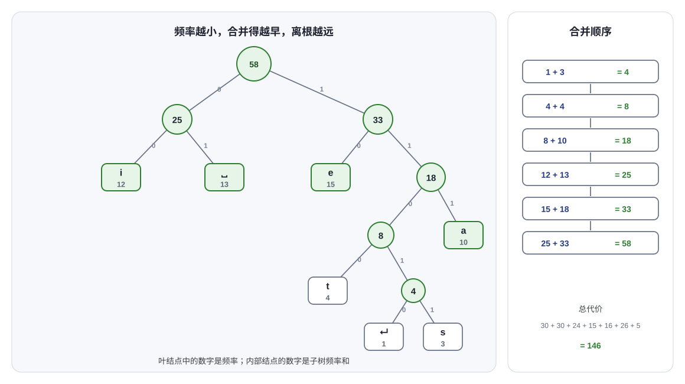

# 第九讲：贪心算法（Greedy Algorithms）

> 动态规划会把每个状态下的多种选择都留着，贪心则当场选定一个候选，后面不再回头。这样做能不能得到最优解，不能靠“看起来合理”判断，必须证明当前选择总能出现在某个最优解里。这一讲用活动选择说明怎样排除错误的贪心规则，再用 Huffman 编码跑一遍交换论证和最优子结构。

---

## 1. 贪心框架（Greedy Method）

### 1.1 可行解与最优解

一个优化问题（optimization problem）给出一组约束和一个优化目标。满足全部约束的解叫可行解（feasible solution），在所有可行解里让目标函数取得最好值的解叫最优解（optimal solution）。

活动选择要最大化兼容区间的数量，Huffman 编码要最小化编码总长度。两者都有候选集合、可行性条件和目标函数，只是“当前哪个候选最好”需要分别设计。

贪心法（greedy method）在每一步按某个贪心准则选一个候选，并且假定这个选择以后不会撤销。选择时至少要保持可行性：已经选过的活动不能和下一个活动重叠，已经合并的两棵 Huffman 子树也不能再拆开。

保持可行性只能说明算法会输出一个合法解，还不能说明它是好解。局部最好的候选未必能通向全局最优。贪心真正需要的条件是：无论当前局面是什么，选中的候选都能和某个最优解的其余部分拼在一起。

> [!NOTE]
> **贪心选择性质（greedy-choice property）**
>
> 对当前子问题，贪心选择总能出现在该子问题的某个最优解中。做完这一步以后，剩下的原问题仍要满足最优子结构。

### 1.2 交换论证的固定套路

证明贪心选择性质，最常用的是交换论证（exchange argument）。拿一个最优解 $A$，如果它没有采用贪心选择 $g$，就把 $A$ 里的某个元素换成 $g$，再检查三件事：

1. 换完以后仍然满足所有约束；
2. 解的大小、总权重或总代价没有变差；
3. 剩下的部分仍然可以按原来的最优方式处理。

活动选择里，把最早结束的活动 $a_m$ 换进最优集合；Huffman 编码里，把频率最小的两个符号换到最深的一对兄弟叶结点。两处都只是调整最优解的形状，最优值本身没有被破坏。

做完贪心选择以后，剩余问题的最佳解还要能和当前选择合并成原问题的最佳解。这就是最优子结构（optimal substructure）。如果剩余部分单独最优、合回去却反而更差，说明当前状态的描述漏掉了某些约束。

### 1.3 和动态规划放在一起

| 方面 | 贪心 | 动态规划 |
|------|------|----------|
| 当前决策 | 选一个，之后不改 | 保留跳过、选中等多种可能 |
| 状态 | 通常只有一条构造路径 | 每个子问题保留一个最优值 |
| 正确性核心 | 贪心选择总能被某个最优解接受 | 最优子结构和无后效性 |
| 典型代价 | 排序加扫描，常有 $O(N\log N)$ | 状态数和每个状态的转移共同决定 |

活动选择不加权时，最早结束时间能把动态规划中的许多候选压成一条安全路径。给每个活动加上权重后，这条路径就不一定最好了。Huffman 编码仍然可以用贪心，因为“合并两个最小频率”有单独的交换论证。

一个正确的贪心算法，经常可以看成把动态规划里永远不会选的分支剪掉。剪枝的依据必须写出来，不能只凭“当前这一步最划算”。

### 1.4 先检查模型

实现前要确定区间端点是否相等时算不算重叠。本讲统一采用半开区间 $[s_i,f_i)$，于是

$$
s_i\ge f_j
\quad\text{或}\quad
s_j\ge f_i
$$

时，两个活动兼容。若题目把区间写成闭区间，等号两边的条件就要改，否则会把紧挨着的活动误判成冲突。

还要确定无解、空集、单个符号和相同权重怎么处理。贪心算法的正确性证明通常能覆盖这些边界，代码不一定能。平局也不能改变安全选择的性质，后面两个问题都会碰到相同权重或相同结束时间。

---

## 2. 活动选择（Activity Selection）

### 2.1 问题与样本

有 $N$ 个活动 $a_1,a_2,\dots,a_N$，活动 $a_i$ 占用一段资源的时间是 $[s_i,f_i)$。同一时刻资源只能供一个活动使用，要选出数量最多的互不冲突活动。

课件给出的样本如下，已经按结束时间从小到大排列：

| 活动 | $s_i$ | $f_i$ |
|------|------:|------:|
| $a_1$ | 1 | 4 |
| $a_2$ | 3 | 5 |
| $a_3$ | 0 | 6 |
| $a_4$ | 5 | 7 |
| $a_5$ | 3 | 9 |
| $a_6$ | 5 | 9 |
| $a_7$ | 6 | 10 |
| $a_8$ | 8 | 11 |
| $a_9$ | 8 | 12 |
| $a_{10}$ | 2 | 14 |
| $a_{11}$ | 12 | 16 |

从图里可以先看出一组可行选择：$a_1,a_4,a_8,a_{11}$。它们分别占用 $[1,4)$、$[5,7)$、$[8,11)$、$[12,16)$，相邻活动之间还留着空隙。

<div style="overflow-x:auto; padding-bottom:0.5rem;">
  
</div>

窄屏时左右滑动看图。横轴是时间，每一行放一个活动。灰色区间是未选候选，绿色区间是贪心依次选出的活动。活动按结束时间从上到下排列，所以扫描顺序就是 $a_1,a_2,\dots,a_{11}$。

### 2.2 从区间动态规划看

加入两个虚拟活动：$a_0$ 在时间 0 之前结束，$a_{N+1}$ 在无穷远才开始。令 $S_{ij}$ 表示在 $a_i$ 结束以后开始、并且在 $a_j$ 开始以前结束的活动集合。

如果 $S_{ij}$ 为空，最优集合大小是 0。否则选一个 $a_k\in S_{ij}$ 作为当前段里的第一项，问题就拆成 $S_{ik}$ 和 $S_{kj}$：

$$
c_{ij}
=
\begin{cases}
0, & S_{ij}=\varnothing,\\[4pt]
\displaystyle\max_{a_k\in S_{ij}}
\left(c_{ik}+c_{kj}+1\right), & S_{ij}\ne\varnothing.
\end{cases}
$$

这个递推没有提前决定哪个活动最好。它把每个可能的 $a_k$ 都试一遍，左右两段再分别求最优。这样得到正确答案，但计算量取决于状态数和每个状态的候选数。

也可以先按结束时间排序，直接写前缀动态规划。令

$$
p(j)=\max\{\,i<j\mid f_i\le s_j\,\},
$$

若不存在兼容的前驱，就记 $p(j)=0$。$p(j)$ 是第 $j$ 个活动开始前，最后一个已经结束的活动编号。于是

$$
dp[j]
=
\max\left\{
dp[j-1],\,
dp[p(j)]+1
\right\},
\qquad
dp[0]=0.
$$

第一类是不选 $a_j$，第二类是选了 $a_j$，再拼上它之前能兼容的最优解。用扫描求所有 $p(j)$ 是 $O(N^2)$；排序后用二分查找，整体就是 $O(N\log N)$。

### 2.3 哪些贪心规则会出错

课件列出了几种看起来自然的规则，再逐个检验：

| 规则 | 结果 |
|------|------|
| 最早开始的区间优先 | 样本中先选 $a_3=[0,6)$，之后最多只能得到 3 个活动 |
| 最短区间优先 | 中间的小区间可能同时挡住两侧两个兼容区间 |
| 剩余冲突最少的区间优先 | 冲突数是个局部指标，平局时也可能选中不安全的区间 |
| 最早结束的区间优先 | 对样本得到 $a_1,a_4,a_8,a_{11}$，一共有 4 个 |

最短区间的独立反例更清楚。取

$$
L=[0,4),\quad
M=[2,5),\quad
R=[4,7).
$$

$L$ 和 $R$ 在时间 4 相接，可以同时选中；$M$ 的长度只有 3，却同时和 $L,R$ 重叠。最短区间规则先拿 $M$，最后只能选 1 个，最优答案是 $L,R$ 两个。

冲突数规则的问题在于，它只数当前有几个邻居，没有说明选了这个邻居以后，剩下的哪些活动还能拼成最优解。正确的交换证明需要“把贪心选择换进某个最优集合”，冲突数本身给不出这一步。

样本还能直接排掉“最早开始”：

$$
a_3=[0,6),
\quad
a_7=[6,10),
\quad
a_{11}=[12,16).
$$

先选 $a_3$ 后，这三个活动恰好都兼容，但数量只有 3。最早结束规则选了 $a_1$，虽然 $a_1$ 开始得更晚、结束得更早，却给后面的 $a_4,a_8,a_{11}$ 留出了位置。

### 2.4 最早结束时间

正确规则是：在剩余兼容活动里，选结束时间最早的一个。

可以把活动先按结束时间排序，再线性扫描。变量 `lastFinish` 记录已选活动最后一次结束的时间。当前活动开始时间不小于 `lastFinish`，它就与前面的选择兼容。

```cpp
#include <algorithm>
#include <iostream>
#include <limits>
#include <vector>
using namespace std;

struct Activity {
    int start;
    int finish;
    int id;
};

int main() {
    vector<Activity> activities = {
        {1, 4, 1},   {3, 5, 2},   {0, 6, 3},
        {5, 7, 4},   {3, 9, 5},   {5, 9, 6},
        {6, 10, 7},  {8, 11, 8},  {8, 12, 9},
        {2, 14, 10}, {12, 16, 11},
    };

    sort(activities.begin(), activities.end(),
         [](const Activity& a, const Activity& b) {
             if (a.finish != b.finish) {
                 return a.finish < b.finish;
             }
             return a.start < b.start;
         });

    long long lastFinish = numeric_limits<long long>::min();
    vector<int> chosen;

    for (const Activity& activity : activities) {
        if (activity.start >= lastFinish) {
            chosen.push_back(activity.id);
            lastFinish = activity.finish;
        }
    }

    cout << chosen.size() << '\n';  // 4
    for (int id : chosen) {
        cout << id << ' ';
    }
    cout << '\n';  // 1 4 8 11
}
```

扫描时不需要再比较所有剩余活动。排序以后，结束时间不会倒回去；当前活动若和最近一次选择冲突，后面结束时间更晚的活动也不会因为继续等待而变得兼容。换一个说法，资源在下一次活动开始时是否空闲，只取决于上一次选择什么时候结束。

### 2.5 为什么最早结束是安全的

设当前子问题为 $S$，其中所有活动都与已经选过的活动兼容。令 $a_m$ 是 $S$ 中结束时间最早的活动。任取一个最优集合 $A\subseteq S$，把 $A$ 按结束时间排列，令 $a_e$ 是 $A$ 中最早结束的活动。

如果 $a_m=a_e$，最优解已经包含贪心选择。否则把 $a_e$ 替换成 $a_m$，得到

$$
A'=(A-\{a_e\})\cup\{a_m\}.
$$

$a_m$ 属于 $S$，所以它和进入当前子问题之前的已选活动都兼容。又因为

$$
f_m\le f_e,
$$

原来能排在 $a_e$ 后面的活动，开始时间都不小于 $f_e$，自然也不小于 $f_m$。于是 $a_m$ 不会与 $A$ 中其余活动冲突，$A'$ 仍然可行。

替换前后都只有 $|A|$ 个活动，所以 $A'$ 也是最优解。当前选择做完以后，剩下的是“开始时间不早于 $f_m$”的同类子问题，最优子结构也成立。反复应用这两条性质，每一步都至少有一个最优解接受当前选择。

这个证明没有保证“只看结束时间就能知道全局答案”，只说选结束最早的活动不会把最优解排除掉。每次在剩余兼容活动里重做同样的选择，最后才得到全局最优。

复杂度是排序 $O(N\log N)$、扫描 $O(N)$，合计 $O(N\log N)$。保存答案需要 $O(N)$ 空间；如果只输出数量，扫描本身只需要 $O(1)$ 的额外空间。

### 2.6 加权重以后

若活动 $a_j$ 的权重为 $w_j$，目标变成最大化所选活动的总权重。前缀动态规划仍然成立：

$$
dp[j]
=
\max\left\{
dp[j-1],\,
dp[p(j)]+w_j
\right\}.
$$

最早结束的贪心却可能失败。例如

$$
A=[0,2),\,w_A=1,
\quad
B=[1,3),\,w_B=100,
\quad
C=[3,5),\,w_C=100.
$$

最早结束先拿 $A$，之后只能再拿 $C$，总权重是 101；跳过 $A$ 可以同时选 $B,C$，总权重是 200。这里“换入最早结束的活动”会改变总权重，原来的交换论证失去作用。

课件在后面问，若每个活动都有权重，动态规划解法是否仍然正确、贪心解法是否仍然正确。答案是前者仍然成立，后者不能直接沿用。

---

## 3. Huffman 编码（Huffman Codes）

### 3.1 为什么要变长编码

假设一段长度为 1000 的文本只含 `a`、`u`、`x`、`z` 四个字符。若每个字符占一个字节，总共要 $1000\times 8=8000$ 位。字符集大小为 4，用两位二进制已经能区分四个字符：

$$
a=00,\quad
u=01,\quad
x=10,\quad
z=11.
$$

此时每个字符固定占两位，总长度是 2000 位，另外还要保存一张很小的编码表。固定长度编码（fixed-length code）简单，但每个字符的位数相同，出现频率低的字符也占同样多。

若字符集大小为 $C$，固定长度编码至少要 $\lceil\log_2 C\rceil$ 位才能给每个字符一个不同码字。

文本 `aaaxuaxz` 中，各字符出现次数为

$$
f(a)=4,\quad
f(u)=1,\quad
f(x)=2,\quad
f(z)=1.
$$

换成变长编码（variable-length code）

$$
a=0,\quad
u=110,\quad
x=10,\quad
z=111,
$$

整个串编码成

```text
00010110010111
```

一共 14 位，比固定两位编码的 16 位更短。高频字符 `a` 只占一位，低频字符 `u,z` 占三位。

变长编码不能随便给。若把 `a` 编成 `0`，又把某个字符编成 `01`，读到开头的 `0` 时，接收方无法确定这是一个完整的 `a`，还是另一个编码的开头。需要前缀码（prefix code）：任何字符的码字都不能是另一个字符码字的前缀。

### 3.2 用二叉树表示编码

前缀码可以放成一棵二叉树。从根往左记为 0，往右记为 1；字符只放在叶结点。根到某个叶子的路径就是它的码字。

叶结点不能出现在另一个叶子的路径上，这正是“没有码字是另一个码字的前缀”。解码时从根开始，按输入位向左或向右走，碰到叶子就输出该字符，再回到根。

若字符 $c_i$ 的深度是 $d_i$，出现频率是 $f_i$，整份文本的编码总位数是

$$
L(T)=\sum_i f_i d_i.
$$

课件样本 `aaaxuaxz` 的固定两位编码，每个字符深度都是 2：

$$
2\cdot4+2\cdot1+2\cdot2+2\cdot1=16.
$$

改用上面的变长编码后：

$$
1\cdot4+3\cdot1+2\cdot2+3\cdot1=14.
$$

最优前缀码的二叉树通常还可以假定是满二叉树（full binary tree）：每个内部结点都有两个孩子。若某个内部结点只有一个孩子，把父结点和唯一的子结点合并，所有叶子的深度都会减少，编码总长度随之下降。因此最优树不需要单分支结点。

### 3.3 合并频率最小的两棵树

Huffman 算法把字符都看成只有根结点的单结点树，并放进最小堆。每次取出频率最小的两棵树，新建一个内部结点，把这两棵树接到它左右，再把新树放回堆中。重复 $C-1$ 次，直到堆里只剩根结点。

```text
Huffman(C):
    create C single-node trees and insert them into a min-heap H

    for i = 1 to C - 1:
        x = ExtractMin(H)
        y = ExtractMin(H)
        z = new internal node
        z.left = x
        z.right = y
        z.weight = x.weight + y.weight
        Insert(H, z)

    return ExtractMin(H)
```

频率小的字符会较早被合并，因此离根更远；频率大的字符晚一些合并，通常离根更近。左右孩子交换、同频率结点先取哪一个，都会改变具体码字，但不会改变最小总代价。

### 3.4 课件样本

字符和频率如下：

| 字符 | `a` | `e` | `i` | `s` | `t` | 空格 | 换行 |
|------|----:|----:|----:|----:|----:|-----:|-----:|
| 频率 | 10 | 15 | 12 | 3 | 4 | 13 | 1 |

总频率是

$$
10+15+12+3+4+13+1=58.
$$

按最小堆依次合并：

| 步骤 | 取出 | 新结点权重 |
|------|------|-----------:|
| 1 | 换行 1、`s` 3 | 4 |
| 2 | `t` 4、上一步的 4 | 8 |
| 3 | 上一步的 8、`a` 10 | 18 |
| 4 | `i` 12、空格 13 | 25 |
| 5 | `e` 15、上一步的 18 | 33 |
| 6 | 上一步的 25、上一步的 33 | 58 |

<div style="overflow-x:auto; padding-bottom:0.5rem;">
  
</div>

窄屏时左右滑动看图。左边的叶结点写着字符和频率，内部结点写着子树频率和；右边的六步记录最小堆每次合并的两个权重。左链 `0`、右链 `1`，从根走到叶子就能读出码字。

按图中的左右约定，得到一张完整码表：

| 字符 | 频率 | 码字 | 深度 | 贡献 |
|------|-----:|------|-----:|-----:|
| `e` | 15 | `10` | 2 | 30 |
| `i` | 12 | `00` | 2 | 24 |
| 空格 | 13 | `01` | 2 | 26 |
| `a` | 10 | `111` | 3 | 30 |
| `t` | 4 | `1100` | 4 | 16 |
| 换行 | 1 | `11010` | 5 | 5 |
| `s` | 3 | `11011` | 5 | 15 |

总代价为

$$
30+24+26+30+16+5+15=146.
$$

频率最低的换行和 `s` 深度最大。`e,i` 和空格的频率较高，码字只有两位。若在频率同为 4 的 `t` 和第一个合并结果之间换一种取法，左右子树可能对调，字符码字会变化，总代价仍然是 146。

### 3.5 贪心选择为什么安全

先证明第一步合并。设 $x,y$ 是频率最低的两个字符。任意一棵最优前缀码树都能整理成满二叉树，所以至少有一对深度最大的兄弟叶子，记为 $a,b$。

把 $x,y$ 的标记换到 $a,b$ 这两个叶子上。树的结构不变，仍然是前缀码。两项最深叶子的贡献换成更低频率不会增加；原来 $x,y$ 所占的较浅位置改由 $a,b$ 填充，又只会减少代价。因此

$$
f_x d_a+f_y d_b
\le
f_a d_a+f_b d_b.
$$

所以存在一棵最优树，使频率最低的 $x,y$ 是一对最深叶子的兄弟。把 $x,y$ 合并成新字符 $z$，权重为 $f_x+f_y$，这个选择不会排除任何最优解。

接着证明最优子结构。把 $x,y$ 从字母表中删掉，换成一个权重为 $f_x+f_y$ 的字符 $z$，得到更小的字母表 $C'$。设 $T'$ 是 $C'$ 的最优编码树，把叶子 $z$ 展开成以 $x,y$ 为孩子的内部结点，得到原字母表的树 $T$。

两种表示的总代价满足

$$
L(T)=L(T')+f_x+f_y.
$$

右边多出来的两项来自 $x,y$ 比 $z$ 多走的一条边。若原字母表还有比 $T$ 更便宜的树，由前面的交换论证，可以把它整理成 $x,y$ 为兄弟叶子的树；再把这对兄弟合并，就会得到一棵比 $T'$ 更便宜的 $C'$ 编码树，和 $T'$ 的最优性矛盾。

两步合起来，每次取两个最小权重都能安全地压成一个权重之和，直到只剩根结点。

### 3.6 完整实现

下面这段程序按“权重小者优先、编号小者优先”的规则合并，打印每个字符的码字和总代价。

```cpp
#include <iostream>
#include <queue>
#include <string>
#include <vector>
using namespace std;

struct Node {
    long long weight;
    int symbol;  // 叶结点存字符下标，内部结点存 -1
    int left;
    int right;
};

struct Item {
    long long weight;
    int id;
};

struct SmallestFirst {
    bool operator()(const Item& a, const Item& b) const {
        if (a.weight != b.weight) {
            return a.weight > b.weight;
        }
        return a.id > b.id;
    }
};

void Encode(int root, const vector<Node>& nodes,
            const string& prefix, vector<string>& code) {
    const Node& node = nodes[root];
    if (node.symbol >= 0) {
        code[node.symbol] = prefix;
        return;
    }
    Encode(node.left, nodes, prefix + "0", code);
    Encode(node.right, nodes, prefix + "1", code);
}

int main() {
    vector<char> symbols = {'a', 'e', 'i', 's', 't', ' ', '\n'};
    vector<long long> frequency = {10, 15, 12, 3, 4, 13, 1};

    int count = static_cast<int>(symbols.size());
    if (count == 1) {
        cout << "code: 0\n";
        cout << "total cost: " << frequency[0] << '\n';
        return 0;
    }

    vector<Node> nodes;
    priority_queue<Item, vector<Item>, SmallestFirst> heap;

    for (int i = 0; i < count; ++i) {
        nodes.push_back({frequency[i], i, -1, -1});
        heap.push({frequency[i], i});
    }

    while (heap.size() > 1) {
        Item x = heap.top();
        heap.pop();
        Item y = heap.top();
        heap.pop();

        int parent = static_cast<int>(nodes.size());
        nodes.push_back({x.weight + y.weight, -1, x.id, y.id});
        heap.push({x.weight + y.weight, parent});
    }

    int root = heap.top().id;
    vector<string> code(count);
    Encode(root, nodes, "", code);

    long long total = 0;
    for (int i = 0; i < count; ++i) {
        total += frequency[i] * static_cast<long long>(code[i].size());
    }

    cout << "total cost: " << total << '\n';  // 146
    for (int i = 0; i < count; ++i) {
        string shown;
        if (symbols[i] == '\n') {
            shown = "\\n";
        } else if (symbols[i] == ' ') {
            shown = "space";
        } else {
            shown = string(1, symbols[i]);
        }
        cout << shown << ": " << code[i] << '\n';
    }
}
```

单个符号的字母表没有合并过程。为了能直接打印和解码，程序给它一个一位码 `0`；若保存了文本长度，也可以用空串表示唯一字符，总位数为 0。

编码每个字符时沿根到叶子的路径走一次，时间与码长成正比。构建堆并进行 $C-1$ 次合并，时间复杂度是

$$
O(C\log C),
$$

空间是 $O(C)$。这里 $C$ 是不同字符的数量，不直接等于待压缩文本的长度。

解码从根开始，一位一位地向下走。走到叶子就输出字符并回到根。前缀码保证途中不会同时命中两个字符；满二叉树保证内部结点下总能继续走。

---

## 4. 证明与实现检查

### 4.1 两种贪心的证明对照

| 问题 | 贪心选择 | 安全性的来源 | 剩余问题 |
|------|----------|--------------|----------|
| 无权活动选择 | 选结束最早的兼容活动 | 换成最早结束活动不会减少后续空间 | 开始时间不早于 $f_m$ 的同类问题 |
| Huffman 编码 | 合并频率最小的两棵树 | 最低频字符可以放到最深兄弟叶子 | 把这两个叶结点压缩成一个权重和 |

两者都用了“替换某个最优解的一部分”这一招。活动选择替换的是最优集合的第一项，Huffman 替换的是最优树最深的一对叶子。替换后目标值不降或代价不增，剩余问题才能继续按同样方法处理。

### 4.2 常见错误

把可行性当成最优性，是最常见的错误。区间不重叠、编码可以解码，这些都只说明结果合法。

只验证几个样例不够。样本可能恰好让错误规则也得到最优值，必须有交换论证或等价的状态转移来证明。

排序键要和目标函数一致。活动选择按结束时间排序，不能只按开始时间；Huffman 按当前子树权重排序，不能只看字符原始频率，因为合并后的内部结点也要参加比较。

半开区间的等号很容易写反。若两个活动在某一时刻首尾相接，它们不冲突；在 Huffman 树中，兄弟叶子的深度相同，左右顺序可以交换。这些细节不改变算法思想，却会让实现的边界测试失败。

动态规划中的某条最优路径看起来像贪心，不代表可以直接写成贪心。只有去掉其他分支以后，仍然能证明每次决策安全，才能减少状态。

---

## 5. 课程项目（Research Project 5）

第五个研究项目叫 Shopping With Coupons (26)。购物清单上有 $N$ 件商品，有 $N$ 种优惠券，每张或每种券能在任意一件商品上省下一部分钱；手里有 $D$ 美元，要尽可能多买几件。

课件只给了题目，详细规则要在 Pintia 对应题目集里下载。建模前先确认这些约束：

- 每件商品最多使用一张券，还是可以叠加多张；
- 每种券只有一张，还是可以反复使用；
- 优惠金额是否随商品变化，优惠后价格能否为负；
- 商品和优惠券的配对是否会影响总花费；
- 目标是最大化件数，还是件数相同时再最小化剩余预算。

“买得最多”不是简单按原价排序，也不是永远用面额最大的券。优惠后的价格会改变候选顺序，券和商品还可能形成一对一的匹配。先确定哪些选择是可行的，再决定用贪心、动态规划还是图上的最短路；没有证明时，贪心只能先当启发式。

---

## 参考资料

1. 课程材料：第九讲 Greedy Algorithms 课件，活动选择样本、四个备选贪心规则、动态规划对照、Huffman 编码及其两条正确性引理均取自该课件。
2. M. A. Weiss, *Data Structure and Algorithm Analysis in C* (2nd Edition): Ch.10（算法设计技巧，贪心算法与 Huffman 编码）。
3. T. H. Cormen, C. E. Leiserson, R. L. Rivest, C. Stein, *Introduction to Algorithms* (3rd Edition): Ch.16（p.415–437，贪心算法）。
4. 正文补充：活动选择的前缀动态规划、三种错误贪心规则的对照例子、带权活动选择反例、完整 C++ 实现和 Huffman 码表。活动样本、编码代价和程序输出均已逐项核算。
