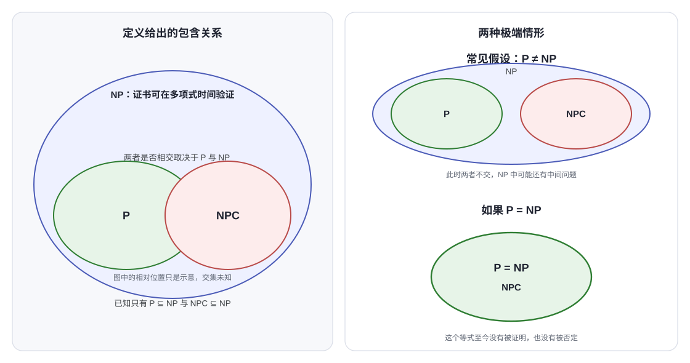
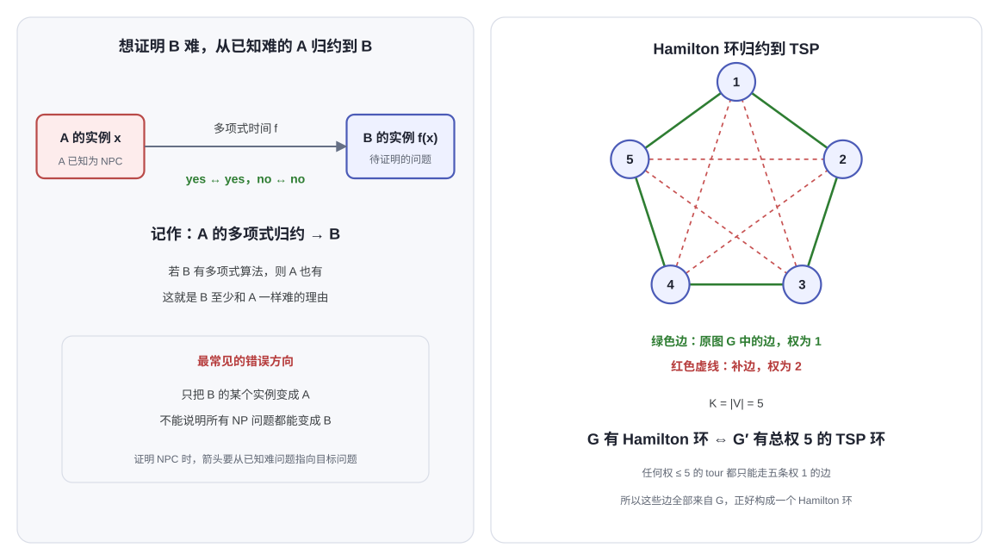
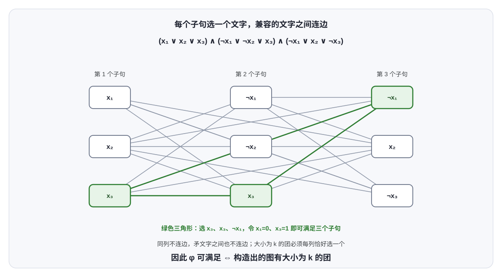

# 第十讲：NP 完全性（NP-Completeness）

> 前面一直在找更快的算法，这一讲换了个问题：如果一直找不到多项式算法，能不能说明问题本身很难？NP 完全性提供了一套比较问题难度的语言。证明一个问题 NP 完全，并不等于已经证明它没有多项式算法，而是把它和一大批长期没有多项式算法的问题绑在了同一条线上。

---

## 1. 难题从哪里开始

### 1.1 只差一个词，难度可能完全不同

课件先并排放了几组相似问题：

| 容易的问题 | 困难的问题 |
|------------|------------|
| Euler 回路：每条边恰好经过一次 | Hamilton 环：每个顶点恰好经过一次 |
| 单源无权最短路 | 单源无权最长简单路 |
| 2-CNF 可满足性 | 3-CNF 可满足性 |

图的规模和输入长度差不多，问题描述也只差几个词，复杂度却分到了两边。最短路可以用广度优先搜索在线性时间内解决；要求路径不能重复顶点、又要尽可能长时，朴素做法要枚举大量路径，目前没有多项式算法。

这些“困难问题”大多不是无法计算。给定一个有限的图和有限的目标长度，总可以枚举候选去判断。问题是候选数量随输入规模增长得太快，$2^N$ 或 $N!$ 这样的搜索不能当作多项式算法。

### 1.2 停机问题：有些问题连有限时间内的判定都做不到

课件用无限循环检查器引出不可判定问题（undecidable problem）。假设有一个程序 `Halt(P, x)`，对任意程序 $P$ 和输入 $x$，都能正确回答 $P(x)$ 是否最终停机。构造

```text
D(P):
    if Halt(P, P) says "halts":
        loop forever
    else:
        halt
```

再把 $D$ 自己交给 $D$：

- 若 `Halt(D, D)` 回答“停机”，$D(D)$ 会进入死循环，与回答矛盾；
- 若 `Halt(D, D)` 回答“不停机”，$D(D)$ 会立刻停机，又与回答矛盾。

两边都不可能正确，所以不存在一个对所有程序和输入都有效的停机判定器。编译器可以识别一些常见的死循环模式，但不能保证识别所有无限循环。

停机问题是可判定问题的反例，但它不在 NP 里。NP 讨论的是可以给出有限证书、并且证书能多项式时间验证的判定问题。停机问题连“所有输入都停机并给出 yes/no”都做不到，已经超出了 NP 的范围。

非 Hamilton 图问题要单独分清。给定一个图，问它是否不存在 Hamilton 环，这个问题当然可以枚举所有顶点排列来判断，所以它是可判定的。它也是 Hamilton 环判定问题的补语言。除非能证明这个补语言也在 NP（若 $\mathrm{NP}=\mathrm{coNP}$ 就会自动成立），否则不能把它算作已知的 NP 问题。课件这一页的排版比较乱，应按证书定义理解，不能把“可判定”与“属于 NP”混为一谈。

---

## 2. 判定问题与输入编码

### 2.1 优化问题先改成判定问题

NP 完全性直接定义在判定问题（decision problem）上，答案只能是 yes 或 no。优化问题通常可以加一个阈值，转成相关的判定问题：

| 优化目标 | 对应判定问题 |
|----------|--------------|
| 最长简单路最长能有多长 | 是否存在长度至少为 $K$ 的简单路 |
| 最大团有多大 | 是否存在大小至少为 $K$ 的团 |
| 最小顶点覆盖有多小 | 是否存在大小至多为 $K$ 的顶点覆盖 |
| TSP 最短回路有多短 | 是否存在总费用至多为 $K$ 的回路 |
| 背包最多装多少价值 | 是否存在价值至少为 $V$、重量至多为 $W$ 的子集 |

若优化问题有多项式算法，对应的判定问题通常也能多项式解决：先求最优值，再和 $K$ 比较。反过来不一定这么直接，但一旦判定问题已经很难，优化问题就不可能比它容易。

这条关系解释了为什么只研究 yes/no 问题也能影响优化问题。若能在多项式时间内求最短 TSP 回路，当然能回答“是否存在费用至多 $K$ 的回路”；若判定版本已经被证明很难，精确求最优值也至少包含同样的难度。

### 2.2 输入长度不是数字大小

算法复杂度按编码后的位数计算。整数 $N$ 用二进制表示时，输入长度是

$$
\Theta(\log N).
$$

一个 $O(N)$ 算法在这个标准编码下其实是指数时间。例如把整数写成 $N$ 个 `1`，输入长度就变成 $N$，同一个算法看起来又成了线性的。这就是为什么 NP 完全性默认使用二进制或其他多项式相关编码，不能随便用 unary 编码改变结论。

子集和问题的动态规划常写成 $O(nW)$。它对数值 $W$ 是多项式的，对编码长度 $\log W$ 却可能是指数的。这类算法叫伪多项式算法（pseudo-polynomial algorithm）。当 $W$ 很大时，$O(nW)$ 仍然可能不可接受。

---

## 3. P、NP 与 co-NP

### 3.1 多项式时间可判定

把输入视为二进制串，问题 $L$ 是所有回答 yes 的输入串集合。若存在算法对每个串都停机，并且正确判断它是否属于 $L$，运行时间是 $O(N^k)$，则 $L\in\mathrm P$。

这里用“判定”（decide），不是只说“识别”（accept）。一个算法可以只在属于 $L$ 的输入上输出 1，遇到不属于 $L$ 的输入时永远不结束，这也算识别语言；判定则要求所有输入都停机并给出正确答案。

### 3.2 NP 是证书可验证

NP 最初叫 nondeterministic polynomial time，后来更常用等价的证书定义。

> [!NOTE]
> **定义：NP**
>
> 判定问题 $L$ 属于 NP，当且仅当存在多项式时间验证算法 $A$ 和常数 $c$，使得对每个输入 $x$，
>
> $$
> x\in L
> \iff
> \exists y,\ |y|=O(|x|^c),\ A(x,y)=1.
> $$
>
> 这里的 $y$ 叫证书（certificate），也叫 witness。

Hamilton 环问题的证书就是按顺序排列的所有顶点。验证器需要检查：

- 序列确实包含每个顶点一次；
- 相邻顶点之间都有边；
- 最后一个顶点能回到起点。

这些检查是 $O(V+E)$，所以 HAM-CYCLE 属于 NP。TSP 的证书是一条 tour，验证器检查排列、所有边存在、总费用不超过 $K$。3-SAT 的证书是一组真假赋值，代入公式后检查每个子句是否满足。

证书长度必须是输入规模的多项式。否则即使验证只做一次线性扫描，扫描一个指数长度的证书也已经不是多项式验证。

如果一个问题已经有多项式判定算法，就把证书参数忽略掉，直接运行判定算法。因此

$$
\mathrm P\subseteq \mathrm{NP}.
$$

NP 不代表“非多项式”。它表示“答案有短证书、验证很快”。一个 NP 问题可以在指数时间暴力搜索全部证书，也可以在尚未发现多项式算法时属于 NP。

### 3.3 NP、co-NP 与 P 是否相等

co-NP 是所有补语言属于 NP 的语言集合：

$$
\mathrm{coNP}
=
\{L:\overline L\in\mathrm{NP}\}.
$$

若一个问题在 NP 中，它问的是“是否存在一个证书”；补问题往往问“是否所有候选都不行”，证书的形式就变了。P 对补运算封闭，所以

$$
\mathrm P\subseteq\mathrm{NP}\cap\mathrm{coNP}.
$$

目前不知道 NP 与 co-NP 是否相等，也不知道 P 是否等于 NP。最常被接受的图景是 $\mathrm P\ne\mathrm{NP}$，但这不是定理。

<div style="padding-bottom:0.5rem;">
  
</div>

点击图片可放大查看。左图只表达定义能推出的包含关系，P 与 NPC 是否相交取决于 P 与 NP 的关系；右侧把最常见的猜测和 $P=NP$ 时的塌缩放在一起。图中的包含关系不是对未解问题的断言。

---

## 4. 语言、归约与 NP 完全

### 4.1 用语言重写判定问题

固定有限字母表 $\Sigma$，例如 $\{0,1\}$。一个语言是

$$
L\subseteq\Sigma^*.
$$

空串记作 $\varepsilon$，空语言是 $\varnothing$，所有字符串的集合是 $\Sigma^*$。语言可以做并、交、补、连接（concatenation）和 Kleene 闭包。一个判定问题对应一个语言：所有回答 yes 的实例编码组成的集合。

算法 $A$ **识别**语言 $L$，是指对 $x\in L$ 输出 1；算法 $A$ **判定**语言 $L$，是指对每个输入都停机，并且输出 1 当且仅当 $x\in L$。P 的定义要求判定，不是只在 yes 实例上承认。

### 4.2 多项式归约的方向

语言 $L_1$ 多项式时间归约到 $L_2$，记作

$$
L_1\le_P L_2,
$$

当且仅当存在多项式时间可计算的函数 $f$，使得对所有输入串 $x$，

$$
x\in L_1
\iff
f(x)\in L_2.
$$

如果 $L_1\le_P L_2$，那么 $L_1$ 不会比 $L_2$ 更难。给定 $L_1$ 的实例，先多项式时间变成 $L_2$ 的实例，再用 $L_2$ 的算法回答。如果 $L_2$ 能多项式解决，$L_1$ 也能。

证明一个新问题 $B$ 很难时，方向正好是

$$
\text{已知 NPC 的 }A
\longrightarrow
\text{待证明的 }B.
$$

这才是把 $A$ 的难度传给 $B$。如果只把 $B$ 的一个实例变成 $A$，只能说明这个特定实例可以借助 $A$ 解决，不能说明所有 NP 问题都能变成 $B$。

<div style="padding-bottom:0.5rem;">
  
</div>

点击图片可放大查看。左图强调箭头从已知 NP 完全问题指向目标问题；右图把一个 Hamilton 环问题补成完全图，原图边权为 1，补边权为 2。只要目标 tour 的总权不超过顶点数，就不可能使用任何补边。

### 4.3 NP-hard 与 NP-complete

若所有 NP 语言都能多项式归约到 $L$，称 $L$ 是 NP-hard。若还要求

$$
L\in\mathrm{NP},
$$

则 $L$ 是 NP-complete，记作 $L\in\mathrm{NPC}$。

NP-complete 同时有两个条件：

1. 至少和所有 NP 问题一样难；
2. 自己的 yes 答案有短证书。

只证明第一条得到 NP-hard。很多不可判定问题也是 NP-hard，但它们不在 NP，所以不是 NP-complete。

已有第一个 NP-complete 问题以后，证明新问题 $B$ 是 NPC 通常只需要：

1. 证明 $B\in\mathrm{NP}$：说明证书是什么，并给出多项式验证算法；
2. 选一个已知 NPC 问题 $A$；
3. 写出多项式时间归约 $A\le_P B$；
4. 证明 yes/no 等价，也就是两个方向都要成立。

归约具有传递性。若所有 NP 问题都能归约到 $A$，而 $A$ 又能归约到 $B$，就得到所有 NP 问题都能归约到 $B$，不必每次从头枚举整个 NP。

---

## 5. 第一个 NP 完全问题

### 5.1 电路可满足性

布尔组合电路由 NOT、AND、OR 门和导线组成，不含环。给所有输入赋值以后，电路逐层计算出一个输出。

CIRCUIT-SAT 问题问：是否存在一组输入赋值，使电路输出为 1？

证书就是所有输入位的赋值。沿着电路拓扑顺序计算每一根导线的值，可以多项式时间验证输出是否为 1，所以 CIRCUIT-SAT 属于 NP。

证明它 NP-hard 这件事叫 Cook-Levin 定理。给定任意 NP 问题的多项式验证器，把验证器的计算过程展开成一张多项式大小的计算表，再用电路门编码表格中的状态和转移。电路可满足当且仅当某个证书会让验证器接受。因此所有 NP 问题都能归约到 CIRCUIT-SAT。

Cook 在 1971 年给出了这一结果，所以 CIRCUIT-SAT 是第一个被证明 NP-complete 的问题。后面证明其他问题 NP-complete 时，就有了归约起点。

### 5.2 SAT 与 3-CNF-SAT

SAT 的输入是一般布尔公式，使用变量、NOT、AND、OR、括号等连接词。可满足性证书是一组变量赋值。把赋值代进去求值即可，所以 SAT 属于 NP。

由 CIRCUIT-SAT 可以归约到 SAT：为电路中的每根导线设一个布尔变量，为每个逻辑门写一个等价式，再要求输出变量为 1。电路和公式同真假，归约大小是多项式的。

文字（literal）是一个变量或其否定，例如 $x_i$ 或 $\neg x_i$。子句（clause）是若干文字的 OR，合取范式（CNF）是若干子句的 AND。若每个子句恰好有三个不同文字，就叫 3-CNF。

例如

$$
(x_1\lor x_2\lor \neg x_3)
\land
(\neg x_1\lor x_2\lor x_3)
\land
(x_1\lor \neg x_2\lor x_3)
$$

是一个 3-CNF 公式。3-SAT 问它是否存在满足所有子句的赋值。

SAT 可以归约到 3-SAT：先把公式变成完整括号树，为每个内部结点引入辅助变量，再把长度不足 3 的子句补齐。辅助变量只用来把它们改写成若干等价的 3 文字子句，不改变可满足性。

因此

$$
\text{CIRCUIT-SAT}
\le_P
\text{SAT}
\le_P
\text{3-SAT}.
$$

2-SAT 与 3-SAT 的差异不是装饰。2-SAT 可以转成蕴含图，求强连通分量，在多项式时间内判定；3-SAT 是 NP-complete，也是后续很多问题的标准归约起点。

---

## 6. 3-SAT 归约到 CLIQUE

### 6.1 团问题

图 $G=(V,E)$ 中，若一个顶点子集的任意两个顶点之间都有边，这个子集就叫团（clique）。CLIQUE 判定问题问：$G$ 中是否存在大小至少为 $K$ 的团。

证书是选中的 $K$ 个顶点。验证器只需检查每对顶点之间是否都有边，组合数至多 $O(V^2)$，所以 CLIQUE 属于 NP。

### 6.2 从子句构造图

给定 3-CNF 公式 $\phi$，有 $k$ 个子句，每个子句含 3 个文字。把每个文字出现的位置都设成一个顶点，于是共有 $3k$ 个顶点，并按所属子句分成 $k$ 列。

在两个不同子句的顶点之间加边，当且仅当两个文字不矛盾：

- 不同子句中的同一个文字可以相容，例如 $x_1$ 和 $x_1$；
- 不同子句中的不同变量可以相容，例如 $x_1$ 和 $x_2$；
- $x_i$ 与 $\neg x_i$ 不能连边。

同一个子句内部的顶点之间不加边。构造图只需检查 $O(k^2)$ 对顶点，归约是多项式的。

<div style="padding-bottom:0.5rem;">
  
</div>

点击图片可放大查看。灰色边表示不同子句之间可以同时取的两个文字，绿色三角形是满足所有子句的一个大小 3 的团。选择 $x_3,x_3,\neg x_1$ 后，令 $x_1=0,x_3=1$，三个子句都能满足。

### 6.3 两个方向

若 $\phi$ 有满足赋值，每个子句至少有一个文字为真。每个子句选一个为真的文字，一共选 $k$ 个顶点。任意两个被选文字都为真，不可能互为否定，因此它们之间有边。这个集合形成大小为 $k$ 的团。

反过来，若图中有大小为 $k$ 的团，同列没有边，所以团在每个子句里只能取一个顶点，$k$ 个顶点恰好覆盖 $k$ 个子句。不同列之间存在边，保证被选文字之间没有 $x_i$ 与 $\neg x_i$ 的冲突。给这些被选中的文字赋 1，不会产生矛盾；其余变量任意赋值，就能满足每个子句。

因此

$$
\phi\in\text{3-SAT}
\iff
G_\phi\in\text{CLIQUE}.
$$

CLIQUE 属于 NP，且 3-SAT 能归约到它，所以 CLIQUE 是 NP-complete。

这个构造只用到公式的实例，不需要预先知道满足赋值。构造图时可以机械地枚举文字、检查矛盾并连边；如果归约算法需要先知道 yes/no 答案，它就不是有效的归约。

---

## 7. CLIQUE 归约到 VERTEX-COVER

### 7.1 顶点覆盖

图 $G=(V,E)$ 的顶点覆盖（vertex cover）是一个顶点集合 $C\subseteq V$，使每条边至少有一个端点在 $C$ 中。VERTEX-COVER 判定问题问是否存在大小至多为 $K$ 的顶点覆盖。

证书就是集合 $C$。给定 $C$，先检查 $|C|\le K$，再检查每条边的两个端点是否有至少一个在 $C$ 中。用布尔数组标记 $C$，验证时间是 $O(V+E)$，所以 VERTEX-COVER 属于 NP。

> [!NOTE]
> 课件把这一步写成 $O(N^3)$。如果每次在长度 $O(V)$ 的顶点列表里线性查找成员，确实是 $O(VE)$ 的最粗界；先建一个布尔数组，就能把成员查询降到 $O(1)$，总时间变成 $O(V+E)$。

### 7.2 为什么要在补图上做

定义补图（complement graph）

$$
\overline G=(V,\overline E),
\qquad
(u,v)\in\overline E
\iff
(u,v)\notin E.
$$

标准归约是

$$
f(G,K)=(\overline G,\ |V|-K).
$$

补图可以多项式时间构造，结论是：$G$ 有大小为 $K$ 的团，当且仅当 $\overline G$ 有大小为 $|V|-K$ 的顶点覆盖。

不能在原图 $G$ 上直接断言“$K$ 个顶点的团，补集就是 $|V|-K$ 个顶点的覆盖”。原图团内部的边，其两个端点都在团内，补集碰不到这些边。只有把边集合换成补图，这个证明才成立。

### 7.3 两个方向

若 $G$ 有团 $C$，$|C|=K$。任取补图中的边 $(u,v)\in\overline E$。若 $u,v$ 都在 $C$ 内，$uv$ 就应该是原图的边，与 $C$ 是团矛盾。因此补图的每条边至少有一个端点落在 $V-C$ 中。$V-C$ 的大小是 $|V|-K$，所以它是 $\overline G$ 的一个顶点覆盖。

若 $\overline G$ 有顶点覆盖 $D$，$|D|=|V|-K$。任取 $u,v\in V-D$。如果 $uv$ 不是原图的边，那么 $uv$ 是补图的边；但 $u,v$ 都不在 $D$ 中，这条边就没有被覆盖，产生矛盾。所以 $V-D$ 中任意两个顶点在原图中都相邻，$V-D$ 是大小为 $K$ 的团。

两个方向都成立，CLIQUE 属于 NP-complete，VERTEX-COVER 也属于 NP，所以 VERTEX-COVER 也是 NP-complete。

一个很小的例子：原图 $G$ 是一个三角形加一个孤立顶点。取 $K=3$，补图是一颗以孤立顶点为中心的星。三角形是原图的团，补图的顶点覆盖只需要中心这一个顶点，大小为 $4-3=1$。

下面这段验证器直接检查补图上的顶点覆盖证书：

```cpp
#include <iostream>
#include <utility>
#include <vector>
using namespace std;

bool IsVertexCover(
    int n,
    const vector<pair<int, int>>& edges,
    const vector<int>& cover,
    int k
) {
    if (static_cast<int>(cover.size()) > k) {
        return false;
    }

    vector<char> inCover(n, false);
    for (int vertex : cover) {
        if (vertex < 0 || vertex >= n || inCover[vertex]) {
            return false;
        }
        inCover[vertex] = true;
    }

    for (auto [u, v] : edges) {
        if (!inCover[u] && !inCover[v]) {
            return false;
        }
    }
    return true;
}

int main() {
    // 三角形加孤立顶点 3 的补图
    vector<pair<int, int>> complementEdges = {
        {0, 3}, {1, 3}, {2, 3},
    };

    vector<int> certificate = {3};
    cout << boolalpha
         << IsVertexCover(4, complementEdges, certificate, 1)
         << '\n';  // true

    vector<int> badCertificate = {0, 1};
    cout << IsVertexCover(4, complementEdges, badCertificate, 1)
         << '\n';  // false
}
```

验证器先检查证书大小和重复顶点，再扫描全部边。时间 $O(V+E)$，空间 $O(V)$。

---

## 8. HAM-CYCLE 归约到 TSP

### 8.1 两个判定问题

HAM-CYCLE 给定无向图 $G=(V,E)$，问是否存在一个简单环，恰好访问每个顶点一次。

旅行商问题（traveling-salesperson problem, TSP）的判定版本给定一个带非负边权的完全图 $G'$ 和整数 $K$，问是否存在一条访问所有顶点一次的 tour，总费用至多 $K$。

TSP 的证书是一条顶点序列。验证器检查排列、每条边的费用求和以及总费用是否不超过 $K$，所以 TSP 属于 NP。

### 8.2 把原图补成完全图

给定 Hamilton 环实例 $G=(V,E)$，构造 TSP 实例 $G'$：

$$
w'(u,v)
=
\begin{cases}
1, & (u,v)\in E,\\
2, & (u,v)\notin E.
\end{cases}
$$

令

$$
K=|V|.
$$

完整图包含所有无序顶点对，非负边权满足 TSP 的输入要求。构造只需要遍历 $O(V^2)$ 个顶点对，是多项式的。

若 $G$ 有 Hamilton 环，按环的顺序走就是一个 TSP tour；它的每条边都来自 $G$，所以总权重恰好是 $|V|$。

若 $G'$ 有总权重不超过 $|V|$ 的 tour，tour 恰好含 $|V|$ 条边，每条边权至少为 1，所以每条边权都必须是 1。权 2 的补边一条也不能用，于是 tour 只经过原图的边，正是 $G$ 中的一个 Hamilton 环。

因此

$$
G\in\text{HAM-CYCLE}
\iff
(G',|V|)\in\text{TSP}.
$$

HAM-CYCLE 是 NP-complete，所以 TSP 是 NP-hard；再加上 TSP 属于 NP，TSP 也是 NP-complete。

---

## 9. 其他常见问题与证明模板

### 9.1 子集和

SUBSET-SUM 给定一组正整数和一个目标 $T$，问是否存在子集和恰好为 $T$。证书是选中的子集，验证只需求和，所以它在 NP 中。

从 3-SAT 归约到 SUBSET-SUM 时，会把变量和子句都放在不同十进制数位上。变量选择对应最高位为 1，子句位记录该子句是否被满足；每个子句再用两个 slack 数补到目标位。因为最大一位不超过 6，十进制加法不会产生进位，数位之间彼此独立。

这个归约很能说明“数字问题”的难点：子集和的动态规划 $O(nT)$ 对目标值 $T$ 多项式，对二进制输入长度却不是多项式，因此没有推翻 NP-complete 结论。

### 9.2 常见归约关系

| 起点 | 终点 | 关键构造 |
|------|------|----------|
| CIRCUIT-SAT | SAT | 每根导线一个变量，每个门一个等价式 |
| SAT | 3-SAT | 括号树、辅助变量、补齐子句 |
| 3-SAT | CLIQUE | 每个文字一个顶点，兼容文字连边 |
| CLIQUE | VERTEX-COVER | 取补图，阈值改为 $|V|-K$ |
| VERTEX-COVER | HAM-CYCLE | 用路径 gadget 约束环的走法 |
| HAM-CYCLE | TSP | 原边权 1，补边权 2 |
| 3-SAT | SUBSET-SUM | 变量位、子句位和 slack 数字 |

这张表里 VERTEX-COVER 到 HAM-CYCLE 这一步的 gadget 比较长，课件没有展开证明，只把它作为已知结论使用。证明 TSP 时，归约起点已经可以是 HAM-CYCLE。

### 9.3 写 NP-complete 证明的检查表

| 检查项 | 具体问题 |
|--------|----------|
| 目标在 NP | 证书是什么，长度是否多项式，验证是否多项式 |
| 归约方向 | 是否从已知 NPC 问题指向待证明问题 |
| 覆盖所有实例 | 是否对任意源实例都能机械构造，而不是只构造一个样例 |
| 双向等价 | 源问题 yes 是否推出目标 yes；目标 yes 是否推回源 yes |
| 时间与大小 | 构造算法和输出规模是否都多项式 |
| 不依赖答案 | 构造过程不能先假设源实例是 yes 再决定怎么建 |

### 9.4 常见错误

把归约方向写反，排在第一。证明 $B$ 是 NPC，需要 $A\le_P B$；$B\le_P A$ 不能得到这个结论。

只做归约，不证明 $B\in\mathrm{NP}$，只能得到 NP-hard。NP-hard 问题可能根本不可判定，不能自动称为 NP-complete。

只证一个方向也不够。必须说明源问题何时 yes 对应目标何时 yes，以及目标 yes 时如何反推出源 yes。否则归约可能把 no 实例也变成 yes。

归约构造必须多项式时间，输出规模也必须多项式。直接写一棵可能指数展开的公式树，或者枚举所有候选证书再编码，都会破坏归约。

“NP-complete”不等于“已经证明不存在多项式算法”。它只说明若某个 NPC 问题有多项式算法，则 $\mathrm P=\mathrm{NP}$。今天没有人证明 $\mathrm P\ne\mathrm{NP}$，也没有找到任何 NPC 问题的多项式算法。

---

## 参考资料

1. 课程材料：第十讲 NP-Completeness 课件，停机问题、P/NP、co-NP、形式语言、多项式归约、CIRCUIT-SAT、TSP 和 VERTEX-COVER 的例题均取自该课件。
2. T. H. Cormen, C. E. Leiserson, R. L. Rivest, C. Stein, *Introduction to Algorithms* (3rd Edition): Ch.34（p.1048–1105，NP 完全性）。
3. 补充讲义 `NP-completeness.pdf`：第三十四章中关于多项式验证、Cook-Levin、SAT、3-SAT、CLIQUE、VERTEX-COVER、HAM-CYCLE、TSP 与 SUBSET-SUM 的证明。
4. 正文补充：3-SAT 到 CLIQUE 的完整构造、补图版本的 CLIQUE 到 VERTEX-COVER 证明、$O(V+E)$ 顶点覆盖验证器、常见归约链和证明检查表。所有程序与样例均已单独核对。
