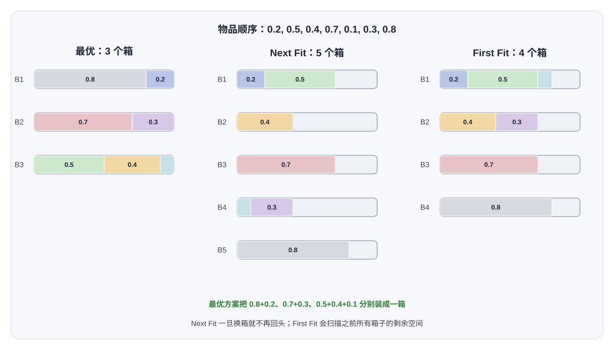
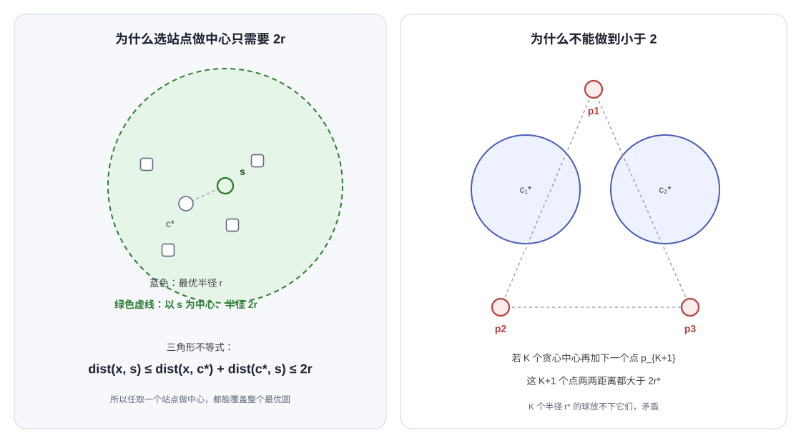

# 第十一讲：近似算法（Approximation Algorithms）

> 精确算法解不动 NP-hard 问题时，近似算法换了一个目标：在多项式时间内保证答案离最优值不远。难点从“能不能求到最优”变成“这个差距最多有多大，以及在哪些输入上可以达到”。这一讲用装箱、背包和 K-center 展示几种常见保证。

---

## 1. 如何面对困难问题

### 1.1 三条路

面对 NP-hard 或 NP-complete 问题，常见选择有三类：

| 方向 | 适用情形 | 代价 |
|------|----------|------|
| 指数时间精确算法 | $N$ 很小，或只运行一次 | 输入稍大就不可用 |
| 特殊情形多项式算法 | 实际数据满足额外结构 | 一般实例仍无法解决 |
| 多项式时间近似算法 | 需要稳定、可证明的可行解 | 不保证最优 |

近似算法不隐藏最坏情况。它给出一个比值，例如保证使用的箱子数不超过最优值的 $1.7$ 倍。这个保证要对所有合法输入成立，不能只说“通常很好”。

启发式（heuristic）和近似算法（approximation algorithm）的区别就在于这张保证。启发式可以很快，也可能在实际输入上表现很好，但没有统一的最坏情况界。

### 1.2 近似比

设算法在规模为 $N$ 的实例上得到费用 $C$，最优费用为 $C^*$，其中 $C,C^*>0$。若对每个该规模的实例都有

$$
\max\left(\frac{C}{C^*},\frac{C^*}{C}\right)
\le \rho(N),
$$

就说这个算法有近似比 $\rho(N)$，或者叫 $\rho(N)$-近似算法。

对最小化问题，通常只需要证明

$$
C\le \rho(N)C^*.
$$

对最大化问题，条件是

$$
C^*\le \rho(N)C.
$$

两种写法都在表达“算法答案与最优答案的比值不超过 $\rho$”。若 $\rho=1$，算法就是精确算法；比值越接近 1，保证越强。

最坏情况界不排除某些实例刚好最优，也不排除实际数据上表现很好。它限制的是全都可以出现的最差差距。

### 1.3 PTAS 与 FPTAS

近似方案（approximation scheme）除了问题实例，还接收精度参数 $\varepsilon>0$。对任何固定的 $\varepsilon$，它给出 $(1+\varepsilon)$-近似。

若对每个固定 $\varepsilon$，运行时间在输入规模 $N$ 上是多项式，则叫多项式时间近似方案，缩写 PTAS。这里的多项式可以依赖 $\varepsilon$，例如 $O(2^{1/\varepsilon}N^2)$ 仍算 PTAS。

若运行时间同时是 $N$ 和 $1/\varepsilon$ 的多项式，则叫完全多项式时间近似方案，缩写 FPTAS。例如 $O(N^3/\varepsilon)$ 是 FPTAS，而 $O(N^2\cdot 2^{1/\varepsilon})$ 只是 PTAS。

这个区分很实用。PTAS 可以把精度调高，但精度每提高一倍，时间可能指数增长；FPTAS 调高精度只会让多项式次数或常数因子变差。

---

## 2. 装箱（Bin Packing）

### 2.1 问题

有 $N$ 个物品，大小 $s_i\in(0,1]$，每个箱子容量为 1。要把所有物品装进尽量少的箱子。

判定“能否用 $K$ 个箱子装下”属于 NP，求最少箱子数的优化问题 NP-hard。课件样本

$$
0.2,\ 0.5,\ 0.4,\ 0.7,\ 0.1,\ 0.3,\ 0.8
$$

的最优装箱是

$$
\{0.8,0.2\},
\quad
\{0.7,0.3\},
\quad
\{0.5,0.4,0.1\}.
$$

一共 3 个箱子。总大小只有 3，所以下界直接取到 3。一般实例中，总大小下界

$$
M\ge\left\lceil\sum_i s_i\right\rceil
$$

不一定能达到，因为碎片可能塞不满。

<div style="overflow-x:auto; padding-bottom:0.5rem;">
  
</div>

窄屏时左右滑动看图。同一大小的物品使用同一种颜色。最优方案 3 箱；Next Fit 因为开新箱后不回头，用了 5 箱；First Fit 会搜索之前所有箱子的剩余空间，用了 4 箱。

### 2.2 Next Fit

Next Fit 只检查当前打开的最后一个箱子。放得下就放，放不下就关掉它，新开一箱。

```text
lastBin = empty
for item in input order:
    if item fits in lastBin:
        put item in lastBin
    else:
        close lastBin
        lastBin = empty
        put item in lastBin
open lastBin
```

设最优箱子数是 $M$。Next Fit 的核心保证是

$$
\operatorname{NF}(I)\le 2M-1.
$$

证明来自相邻 bin 的总大小。每当第 $2i$ 个箱子被打开，第 $2i-1$ 个箱子已经放不进当时的第一个物品，因此

$$
S(B_{2i-1})+S(B_{2i})>1.
$$

若 Next Fit 用了 $2M$ 个箱子，可以得到 $M$ 对箱子，每对总大小都大于 1，所以全部物品总大小大于 $M$。最优装箱至少需要 $M+1$ 个箱子，与假设的 $M$ 矛盾。因此最多 $2M-1$ 个。

这个界是紧的。对任意 $M$，把物品排成

$$
\frac12,\ \varepsilon,\ \frac12,\ \varepsilon,\ \ldots,\ \frac12,
$$

其中 $1/2$ 有 $2M-1$ 个，$\varepsilon$ 有 $2M-2$ 个且足够小。Next Fit 每个 $1/2+\varepsilon$ 占一箱，最后一个 $1/2$ 再占一箱，一共 $2M-1$；最优把两个 $1/2$ 配成一箱，只需要 $M$ 箱。

### 2.3 First Fit 与 Best Fit

First Fit 从第一个箱子开始扫描，找到能放下当前物品的第一个箱子；找不到就新开一箱。

Best Fit 也扫描已有箱子，但选择放入后剩余空间最小的那个。两者都允许使用之前关闭的箱子，所以比 Next Fit 更灵活。

课件给出的最坏情况界是

$$
\operatorname{FF}(I)\le\frac{17}{10}M,
\qquad
\operatorname{BF}(I)\le\frac{17}{10}M.
$$

这个界对 First Fit 和 Best Fit 都是紧的常数比例，存在序列使算法使用的箱子数接近 $17(M-1)/10$。

朴素实现每次扫描所有箱子，最坏 $O(N^2)$。用平衡搜索树或合适的数据结构维护剩余容量，可以做到 $O(N\log N)$。复杂度不能只看排序，还要看每次插入需要比较多少个已有箱子。

### 2.4 在线与离线

在线算法（online algorithm）处理一个物品后，不能知道后面的输入，也不能回头改已经做出的放置。

有一个简单例子可以说明在线算法的限制：

$$
0.4,\ 0.4,\ 0.6,\ 0.6.
$$

在线算法先看到两个 0.4，如果把它们装进同一箱，之后的两个 0.6 无法再配合，至少需要 3 箱。离线算法看到全部输入后，可以配成

$$
\{0.4,0.6\},
\quad
\{0.4,0.6\},
$$

只需要 2 箱。

更强的结论是：任何在线装箱算法都存在输入，使其使用的箱子数至少是最优值的 $5/3$ 倍。这个比值不是某个算法的缺陷，而是在线信息不足造成的下界。

离线算法可以先看完整列表。First Fit Decreasing（FFD）把物品按大小从大到小排序，再运行 First Fit。排序让大块先占位，减少后面留下零碎空间的机会。

课件给出的界是

$$
\operatorname{FFD}(I)
\le
\frac{11}{9}M+\frac{6}{9}.
$$

Best Fit Decreasing 有同样的数量级。排序增加 $O(N\log N)$，主要的支配项仍来自具体的装箱结构。

### 2.5 一个实现

下面用简单扫描实现三种在线算法和 FFD。样例输出箱子数 `5 4 4 3`。

```cpp
#include <algorithm>
#include <cmath>
#include <iostream>
#include <vector>
using namespace std;

constexpr double EPS = 1e-9;

struct Bin {
    double load = 0;
    vector<double> items;
};

vector<Bin> NextFit(const vector<double>& items) {
    vector<Bin> bins;
    for (double item : items) {
        if (bins.empty() || bins.back().load + item > 1 + EPS) {
            bins.push_back({});
        }
        bins.back().load += item;
        bins.back().items.push_back(item);
    }
    return bins;
}

vector<Bin> FirstOrBestFit(const vector<double>& items, bool bestFit) {
    vector<Bin> bins;
    for (double item : items) {
        int chosen = -1;
        double tightestRemainder = 2;

        for (int i = 0; i < static_cast<int>(bins.size()); ++i) {
            if (bins[i].load + item > 1 + EPS) {
                continue;
            }
            double remainder = 1 - bins[i].load - item;
            if (!bestFit || remainder < tightestRemainder) {
                chosen = i;
                tightestRemainder = remainder;
                if (!bestFit) {
                    break;
                }
            }
        }

        if (chosen == -1) {
            bins.push_back({});
            chosen = static_cast<int>(bins.size()) - 1;
        }
        bins[chosen].load += item;
        bins[chosen].items.push_back(item);
    }
    return bins;
}

void Print(const vector<Bin>& bins) {
    for (const Bin& bin : bins) {
        cout << bin.load << ':';
        for (double item : bin.items) {
            cout << ' ' << item;
        }
        cout << '\n';
    }
}

int main() {
    vector<double> items = {0.2, 0.5, 0.4, 0.7, 0.1, 0.3, 0.8};

    auto next = NextFit(items);
    auto first = FirstOrBestFit(items, false);
    auto best = FirstOrBestFit(items, true);

    vector<double> decreasing = items;
    sort(decreasing.begin(), decreasing.end(), greater<double>());
    auto firstDecreasing = FirstOrBestFit(decreasing, false);

    cout << next.size() << ' '
         << first.size() << ' '
         << best.size() << ' '
         << firstDecreasing.size() << '\n';  // 5 4 4 3

    Print(next);
    Print(first);
    Print(best);
    Print(firstDecreasing);
}
```

验证重复物品时用 EPS 避免浮点数加法误差。线性规划模型里这些数可以看成精确有理数，工程实现则要决定容差。

---

## 3. 背包（Knapsack）

### 3.1 分数背包

背包容量为 $M$，物品 $i$ 的重量是 $w_i$，收益是 $p_i$。分数背包允许取一部分，令 $x_i\in[0,1]$：

$$
\max\sum_i p_i x_i
\quad\text{s.t.}\quad
\sum_i w_i x_i\le M.
$$

这时按收益密度

$$
\frac{p_i}{w_i}
$$

从大到小取。最后一个物品若不能整件放入，就取剩余容量允许的比例。

课件样本为

$$
n=3,\quad M=20,
$$

$$
(p_1,p_2,p_3)=(25,24,15),
\qquad
(w_1,w_2,w_3)=(18,15,10).
$$

收益密度分别是

$$
\frac{25}{18}\approx1.39,
\quad
\frac{24}{15}=1.60,
\quad
\frac{15}{10}=1.50.
$$

按密度选物品 2，取满重量 15，收益 24；容量剩 5，再取物品 3 的 $5/10=1/2$，收益 $7.5$。总收益

$$
24+7.5=31.5.
$$

所以最优分数解是

$$
(x_1,x_2,x_3)=(0,1,1/2).
$$

交换论证也能证明它最优：若两件物品都已部分取用，但低密度物品取得了正比例、高密度物品还没取满，把一点重量从低密度物品移到高密度物品，总收益会增加，原来的方案不可能最优。

### 3.2 0-1 背包与朴素贪心

0-1 背包要求 $x_i\in\{0,1\}$。课件样本是

$$
n=5,\quad M=11,
$$

$$
(p_i)=(1,6,18,22,28),
\qquad
(w_i)=(1,2,5,6,7).
$$

最优解是取物品 3 和 4：

$$
w=5+6=11,
\qquad
P=18+22=40.
$$

若只取收益最大的单件物品，会选物品 5，得到收益 28。若按原始收益从大到小继续装，会得到收益 35。按收益密度选并跳过放不下的物品，同样得到 $(1,1,0,0,1)$，收益 35，也不是最优。

纯密度贪心没有常数近似比。设容量为 $M$，物品 A 是 $(w,p)=(1,1)$，物品 B 是 $(M,M-\delta)$。A 的密度略高，算法先取 A，再放不下 B，收益只有 1；最优取 B，收益接近 $M$。$M$ 随输入增大，比值可以无限大。

### 3.3 一个可靠的 2-近似

先把 $w_i>M$ 的物品删掉，因为它们不可能进入合法解。按收益密度从大到小扫描。能装就装；第一次遇到装不下的物品 $j$ 时，记下它的收益 $p_j$，继续扫描后面的物品。最后返回

$$
\max(P_{\text{greedy}},\,p_j).
$$

也就是在完整贪心解和“只拿第一个放不下的物品”之间取收益较大的那个。

先看正确性。分数背包的最优值 $P_{\text{frac}}$ 是 0-1 最优值 $P_{\text{opt}}$ 的上界。分数算法在第一次装不下 $j$ 时，最多再拿 $p_j$ 的部分收益。完整 0-1 贪心解收益不少于此前已经装入的部分组合，所以

$$
P_{\text{opt}}
\le
P_{\text{frac}}
\le
P_{\text{greedy}}+p_j.
$$

另一方面，

$$
\max(P_{\text{greedy}},p_j)
\ge
\frac{P_{\text{greedy}}+p_j}{2}.
$$

于是

$$
P_{\text{opt}}
\le
2\max(P_{\text{greedy}},p_j).
$$

这就是 2-近似。

课件样例中 $P_{\text{greedy}}=35$，第一次放不下的物品 4 收益为 22，所以返回 35。它离最优值 40 很近，但算法依靠上面的界覆盖所有实例，而不是这个样例恰好不错。

只返回 $P_{\text{greedy}}$ 不够。前面那个 A/B 反例中，A 的密度略高却只有收益 1；如果不允许退回去单拿最大收益物品，保证会失效。

### 3.4 按收益做动态规划

设 $W_{i,p}$ 为在物品 $1,\dots,i$ 中恰好取得收益 $p$ 时，所需的最小总重量。边界为

$$
W_{0,0}=0,\qquad W_{0,p}=\infty\ (p>0).
$$

第 $i$ 件物品有选和不选两种：

$$
W_{i,p}
=
\min\left[
W_{i-1,p},\,
w_i+W_{i-1,p-p_i}
\right].
$$

第二种转移在 $p<p_i$ 时不可用。所有重量不超过 $M$ 的 $p$ 中，最大的 $p$ 就是答案。

总收益至多是 $Np_{\max}$，每件物品都要更新这些状态，因此时间是

$$
O(N\cdot Np_{\max})=O(N^2p_{\max}),
$$

空间可以压到 $O(Np_{\max})$。它是伪多项式算法：对数值 $p_{\max}$ 多项式，对收益的二进制位数不是多项式。

### 3.5 FPTAS：缩放收益

收益很大时，可以牺牲一点精度来缩小 DP 表。令

$$
p_{\max}=\max_i p_i,
\qquad
K=\frac{\varepsilon p_{\max}}{N},
$$

并把每件物品的收益缩成整数

$$
\widehat p_i=\left\lfloor\frac{p_i}{K}\right\rfloor.
$$

用上一节的动态规划，在缩放后的收益上求精确最优解。若原问题最优集合为 $S^*$，算法返回集合为 $S$，缩放后的 DP 至少取得和 $S^*$ 一样大的缩放收益。

对任意集合，缩放会丢失每个物品少于 $K$ 的收益，最多损失 $NK=\varepsilon p_{\max}$。又因为 $p_{\max}\le P_{\text{opt}}$，所以

$$
P(S)
\ge
P_{\text{opt}}-\varepsilon p_{\max}
\ge
(1-\varepsilon)P_{\text{opt}}.
$$

这是最大化问题常用的 $(1-\varepsilon)$ 保证，也可以改写成

$$
\frac{P_{\text{opt}}}{P(S)}
\le
\frac{1}{1-\varepsilon}
=
1+O(\varepsilon).
$$

缩放后总收益至多

$$
\frac{Np_{\max}}{K}
=
\frac{N^2}{\varepsilon}.
$$

因此每个物品更新一次状态的动态规划需要

$$
O\left(N\cdot\frac{N^2}{\varepsilon}\right)
=
O\left(\frac{N^3}{\varepsilon}\right).
$$

运行时间同时是 $N$ 和 $1/\varepsilon$ 的多项式，所以是 FPTAS。精度提高一倍，时间大约翻倍；这比原始 DP 随 $p_{\max}$ 爆炸更实用。

---

## 4. K-center

### 4.1 问题与度量

给定 $N$ 个站点和整数 $K$，选 $K$ 个中心，使任意站点到最近中心的距离最大值最小。记中心集合为 $C$：

$$
\operatorname{dist}(s_i,C)
=
\min_{c\in C}\operatorname{dist}(s_i,c),
$$

$$
r(C)=\max_i\operatorname{dist}(s_i,C).
$$

目标是最小化 $r(C)$，约束 $|C|=K$。

这一节要求距离是度量（metric）：

$$
\operatorname{dist}(x,x)=0,
\quad
\operatorname{dist}(x,y)=\operatorname{dist}(y,x),
$$

$$
\operatorname{dist}(x,y)
\le
\operatorname{dist}(x,z)+\operatorname{dist}(z,y).
$$

欧氏距离、最短路距离和历史路线距离通常满足这些条件。任意画出的图距离不一定满足三角不等式，算法保证也会失效。

中心本身不一定要从站点中选。课件先说明候选中心连续，随后使用的算法只从站点里选。这样做会损失常数因子：若最优中心 $c^*$ 覆盖半径 $r$，从它覆盖的站点里任取 $s$，则对同一簇中的站点 $x$，

$$
\operatorname{dist}(x,s)
\le
\operatorname{dist}(x,c^*)+
\operatorname{dist}(c^*,s)
\le 2r.
$$

所以把中心限制在站点上，至多把半径放大到 2 倍。

<div style="overflow-x:auto; padding-bottom:0.5rem;">
  
</div>

窄屏时左右滑动看图。左图用三角不等式说明 2r 足够覆盖一个最优簇；右图用抽屉原理说明若最远点贪心需要更大的半径，就会产生 $K+1$ 个两两距离超过 $2r^*$ 的点，而 $K$ 个最优球无法同时容纳它们。

### 4.2 知道半径时的 Greedy-2r

假设已经知道一个候选半径 $r$。反复从未覆盖站点中任意取一个 $s$ 作为中心，删除所有距离 $s$ 不超过 $2r$ 的站点。

```text
remaining = all sites
centers = empty

while remaining is not empty:
    choose any s in remaining
    add s to centers
    remove every x with dist(x, s) <= 2r

if number of centers <= K:
    return centers
else:
    answer "no K centers can achieve radius r"
```

若算法选出超过 $K$ 个中心，则任意 $K$ 个中心的覆盖半径都大于 $r$。

证明用反证。假设最优中心集合 $C^*$ 只有 $K$ 个，并且半径不超过 $r$。算法选出 $K+1$ 个中心 $c_1,\dots,c_{K+1}$。每选一个中心时，它到之前中心的距离都大于 $2r$。把这些中心按最近的 $C^*$ 中心分到 $K$ 个簇中，由抽屉原理，有两个算法中心落到同一个最优簇。

同一簇中两个站点到同一个最优中心的距离都不超过 $r$，由三角不等式，它们之间距离不超过 $2r$，与“大于 $2r$”矛盾。所以最优半径一定大于 $r$。

### 4.3 二分半径得到 2-近似

实际不知道 $r(C^*)$。可以在 $[0,r_{\max}]$ 上二分，或对所有站点对距离排序后二分。每次用 Greedy-2r 判断“是否存在 $K$ 个中心，半径不超过 $r$”。

找到仍可行的临界半径 $r_1$ 后，算法实际覆盖半径不超过 $2r_1$。由于最优半径 $r^*$ 是可行的，二分不会错过它；所以

$$
2r_1\le 2r^*.
$$

这给出 2-近似。

如果用实数二分，要多做常数轮直到区间足够小；如果只在站点对距离集合上二分，算法和答案都只需要有限多个候选值。

### 4.4 最远点贪心

另一个实现更直接：先任选一个站点作中心，之后每次选择当前离已有中心最远的站点，直到选够 $K$ 个。

```text
centers = { any site }

while |centers| < K:
    choose site s maximizing dist(s, centers)
    centers |= {s}

return centers
```

设最终半径为 $r(C)$，最优半径为 $r(C^*)$。若

$$
r(C)>2r(C^*),
$$

想象继续选下一个中心 $p_{K+1}$，它与前面 $K$ 个中心的距离都大于 $2r^*$。每次贪心选择时，当前半径不会小于最终的 $r(C)$，所以 $p_1,\dots,p_{K+1}$ 两两距离都大于 $2r^*$。

最优的 $K$ 个中心每个覆盖半径 $r^*$。把 $K+1$ 个选出的点放进 $K$ 个最优球中，必有两个落在同一个球里；同球两点距离至多 $2r^*$，矛盾。因此

$$
r(C)\le 2r(C^*).
$$

最远点算法是 2-近似。朴素实现在每轮重新计算所有站点到当前中心的距离，最坏 $O(KN^2)$；如果预存完整距离矩阵，更新和维护最大值可以降到 $O(KN)$，空间 $O(N^2)$。

### 4.5 为什么不能保证小于 2

已知支配集（dominating set）是 NP-complete。给定图 $G=(V,E)$，把顶点作为站点，并定义度量距离：

- 同一点距离为 0；
- 相邻顶点距离为 1；
- 不相邻的不同顶点距离为 2。

这个距离满足三角不等式。$G$ 有大小 $K$ 的支配集，当且仅当存在 $K$ 个中心，使每个站点到最近中心的距离不超过 1。

若存在 $(2-\varepsilon)$-近似算法，最优半径为 1 时，它必须返回半径小于 2；而距离只取整数，返回值只能是 0 或 1。半径 1 正好就是大小为 $K$ 的支配集。于是可以在多项式时间解支配集，推出 $\mathrm P=\mathrm{NP}$。

所以除非 $\mathrm P=\mathrm{NP}$，K-center 没有小于 2 的常数近似。最远点贪心的 2 倍界已经是这个模型下的最优数量级。

---

## 5. 三种目标与课程项目

### 5.1 最优性、效率与全部实例

一个算法理想上要同时满足：

| 方面 | 要求 |
|------|------|
| 最优性 | 输出精确最优解 |
| 效率 | 运行时间多项式 |
| 全部实例 | 对所有合法输入都成立 |

NP-hard 问题通常要在三者中让步。近似算法保留“多项式”和“全部实例”，放弃精确最优性，改为证明一个固定倍数或精度参数。

PTAS/FPTAS 又把“近似到多好”变成可调参数。对实际应用，先确定能接受的误差，再选择对应时间复杂度的方案。

### 5.2 Research Project 6：Texture Packing

第六个研究项目要求把多个矩形纹理打包进一张宽度给定、高度尽可能小的大纹理，并设计、分析一个多项式时间近似算法。

建模前先确认这些约束：

- 矩形是否允许旋转；
- 是否允许空白、缩放或裁剪；
- 是否要求 guillotine 切割，还是任意位置摆放；
- 输入是离线全部已知，还是必须按顺序在线放置；
- 输出只要高度，还是必须给出每个矩形的坐标。

常见思路是先按高度或面积排序，再用 shelf 或分层放置。分析时至少要和面积下界比较，因为

$$
H_{\text{opt}}
\ge
\frac{\text{全部矩形面积}}{W}.
$$

如果算法把每个矩形放进独立水平带，高度可能远大于最优值；如果能按高度分桶并复用同层空白，常数会更小。项目报告里需要同时证明矩形不重叠、不越界，并给出相对于最优高度的上界。

---

## 参考资料

1. 课程材料：第十一讲 Approximation 课件，近似比、PTAS/FPTAS、装箱算法、分数与 0-1 背包、K-center、2-近似证明和下界均取自该课件。
2. M. A. Weiss, *Data Structure and Algorithm Analysis in C* (2nd Edition), 陈越改编: Ch.10（p.359–366，算法设计技巧与近似算法）。
3. T. H. Cormen, C. E. Leiserson, R. L. Rivest, C. Stein, *Introduction to Algorithms* (3rd Edition): Ch.35（p.1106–1140，近似算法）。
4. 正文补充：装箱样例的完整 C++ 实现、0-1 背包 2-近似的安全回退规则、按收益缩放的 FPTAS 证明、K-center 两种 2-近似证明，以及 Texture Packing 的建模检查表。程序和数值均已单独核对。
